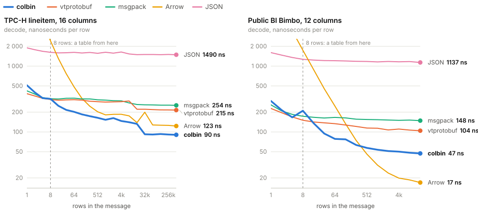

# colbin-benchmarks

[](https://doi.org/10.5281/zenodo.24261123)

**[Read the paper](paper/paper.md)**

The evaluation of [colbin](https://github.com/ivanjoz/colbin), a compact,
hybrid row-columnar serialization format with a self-describing mode, and
the reproducible artifact behind its paper: the datasets, the measurements,
the results and the paper's source, with one command that regenerates every
table and figure in it.

```sh
./reproduce.sh                            # everything: about ten hours
./reproduce.sh --regime web --cases 'schemastore/*' --no-checks   # a smoke test: minutes
make -C paper RUN=../results/<run>        # the paper, on that run's numbers
```

This repository also exists so that colbin itself has no dependencies.
Everything colbin is measured against lives here; `github.com/ivanjoz/colbin`
has an empty `require` block, and nothing in this repository can change that.

- [What is evaluated](#what-is-evaluated)
- [What is in this repository](#what-is-in-this-repository)
- [Methodology](#methodology)
- [Results in brief](#results-in-brief)
- [Reproducing](#reproducing)
- [The paper](#the-paper)
- [Layout](#layout)
- [Known gaps](#known-gaps)

## What is evaluated

Serialization formats for messages write a list of records row by row, and
repeat a field name (JSON) or a tag (Protocol Buffers, MessagePack, CBOR) in
every record. Columnar formats remove that repetition, but they are built
for files and analytical batches, with a fixed cost that outweighs a small
message. colbin is a **hybrid**:

- **A message is written in a row format**, with one byte of header per
  field for a type of up to sixteen fields, zero values not written, and no
  variable-length integers.
- **Inside it, a collection of eight or more records is written column by
  column.** Each integer column goes through a transform chosen per column
  (raw, delta, frame of reference or constant) and is bit-packed in
  byte-aligned blocks of 128 values.
- **The choice is made per value, at encode time.** A three-field
  configuration document and a million-row table are the same format, and
  the encoder needs no hint about which it is writing.
- **There is no build step.** The Go struct is the schema: no interface
  description file, no schema compiler, no generated code.
- **A message can embed its schema** and is then self-describing: any reader
  renders it as JSON without the producer's type.

The evaluation is organised by the three kinds of message the format was
built for, and it keeps the two halves of the design apart:

| kind of message | what it is, in an application | which half it measures |
|---|---|---|
| **bulk tables** | archives and backups of whole tables, where size is the cost | the columns |
| **tables of web size** | the response a server sends a web client, a page of records at a time | the columns |
| **single records** | a record stored as one value in a key-value store or a binary column, a message between two services | the row format alone |

colbin is evaluated as a serialization format in Go: the bytes a Go program
writes and reads, against the Go implementations of the other formats.
Decoding in a browser is a different implementation and is outside the
paper ([`web/`](web/README.md)).

## What is in this repository

- **The datasets**, as scripts. Nothing downloaded is committed: each dataset
  is fetched or generated by its `fetch.sh` and checked against
  [`datasets/MANIFEST.sha256`](datasets/MANIFEST.sha256) before anything
  reads it.
- **The formats.** Eleven formats and implementations beside colbin, each
  behind one Go interface (`formats/`), with their schemas and code generated
  from the same Go types (`cmd/gen`).
- **The harness.** `cmd/colbinbench` times one case per process, pinned to a
  core. `matrix/` holds the cases, the size measurement and the ablations.
  `reproduce.sh` runs all of it in order.
- **The results.** The runs the paper reports are committed under
  [`results/`](results): `paper-v1` (cloud), `paper-v1-laptop` (a second
  machine) and `paper-v1-sweep` (one table at growing row counts). Each
  holds the raw benchmark output, the sizes, a `SUMMARY.md` and the paper's
  tables. [RESULTS.md](RESULTS.md) describes them in full.
- **The paper**: its LaTeX source (`paper/`), in which no number is typed in.

## Methodology

### The data

Four public sources. None was designed for this benchmark.

| dataset | what it is | what is measured | cases |
|---|---|---|---:|
| TPC-H, SF 0.1 | the decision-support benchmark of a wholesale supplier; synthetic | all 8 tables, plus the schema as one message and orders with their lines nested | 10 |
| TPC-DS, SF 0.1 | the decision-support benchmark of a retailer; synthetic, wider tables | all 24 tables | 24 |
| Public BI Benchmark | real tables behind 46 public Tableau workbooks | the first table of each workbook, a seeded random sample, at staggered sizes: 350, 700, ... rows by table, up to 16 384 | 46 |
| SchemaStore | small configuration documents, the corpus of Viotti and Kinderkhedia | all 27 documents, through Go structs and as `map[string]any` | 54 |

- **Each subset follows a rule, not a pick.** Everything at one scale factor
  for TPC-H and TPC-DS, the first table of every workbook for Public BI, the
  corpus authors' selection for SchemaStore.
  [`datasets/README.md`](datasets/README.md) has each rule, the licences and
  the history of every rule that changed.
- **One Go struct per dataset root**, written as a Go programmer would write
  it: the narrowest integer that holds the column, money as integer minor
  units, dates as integer days, a pointer for a nullable column. For the
  three tabular datasets the structs are generated from the sources'
  `CREATE TABLE` statements. Every format's schema is generated from those
  structs, so no format gets a type of its own.
- **134 cases are measured and 107 are reported.** The 27 SchemaStore
  documents as `map[string]any` are measured but left out of the summaries:
  only a few formats can carry them
  ([Known gaps](#known-gaps)).

### Kinds of message

A response to a web client bounds the size of a message. The paper takes
2^14 = 16 384 rows as that bound: a convention, not a measurement. Every
case falls in one of two regimes by its row count alone, and the two are
never pooled:

| regime | rule | kind of message | cases |
|---|---|---|---:|
| `web` | at most 16 384 rows | **tables of web size**: a slice of rows (TPC-H, TPC-DS, Public BI) | 66 |
| | | **single records**: one object with no table in it (SchemaStore) | 27 |
| `bulk` | more than 16 384 rows | **bulk tables** (TPC-H, TPC-DS) | 14 |

SchemaStore's documents are configuration files, not database records. They
stand in for the single record as the public corpus of small typed objects
the evaluation could use. colbin writes none of their rows as a table, so
its results there are the row format's.

### The formats

| format | implementation |
|---|---|
| JSON | `encoding/json/v2` |
| gob | `encoding/gob` |
| CBOR | fxamacker/cbor |
| MessagePack | tinylib/msgp (generated code) and vmihailenco/msgpack (reflection) |
| Protocol Buffers | planetscale/vtprotobuf (generated code) and protobuf-go (reflection) |
| FlatBuffers | google/flatbuffers |
| Arrow | apache/arrow-go, IPC stream |
| Avro | hamba/avro |
| Cap'n Proto | capnproto.org/go/capnp |
| colbin | the default (`colbin`), with `packed5` on (`colbin+packed5`), and self-describing, with its schema embedded (`colbin-json`) |

- Two formats appear with two implementations, because the implementation
  moves the time by more than the format does. The formats to compare colbin
  with on time are the ones with generated code, vtprotobuf and generated
  MessagePack: colbin generates nothing.
- Only `colbin`, the default, is the paper's result. The other two variants
  isolate one option each. A fourth, without field tags
  (`colbin-untagged`), is measured and not reported.
- The versions are the ones [`go.mod`](go.mod) pins.
- A format that cannot carry a case is reported as n/a with the reason, not
  dropped. Arrow carries only roots that are tables.
- Each library is called with its default options, through the interface
  its documentation gives for a hot path.

### What is measured

For each case and format:

1. **Correctness first.** The format encodes the case, decodes it, and the
   result is compared with the original by deep equality. A format that
   fails has no time for that case.
2. **Size.** The message as written, and under gzip 6 and zstd 6. Compressed
   sizes matter because the realistic alternative to a binary format on the
   web is not JSON but compressed JSON.
3. **Time.** Four operations:
   - `encode`, into a reused buffer;
   - `decode-fresh`, into a new value (the "decode" of the tables);
   - `decode-reuse`, into a held one;
   - `access`, the sum of one column, in place where the format allows it.
   For code-generated formats, converting between the format's own types
   and the Go struct is outside the timed region.
4. **Memory.** The bytes and the allocations of each operation, from the
   same samples as the times.

Beside the matrix:

- **Ablations** of the two parameters the table layout rests on: the row
  count at which a slice becomes a table (2, 4, 8, 16, 32) and the column
  transform forced to raw, delta or frame of reference. They measure size
  only, through hooks colbin compiles in only under its `colbin_ablation`
  build tag (`matrix/ablation_test.go`).
- **The sweep**: one table cut to its first 1, 2, 4, … rows, so that only
  the row count moves ([below](#the-sweep)). It shows the hybrid on one
  schema: the row format to the left of eight rows, the columns to the
  right.
- **The composition of each message**: how many of its rows colbin writes
  as tables, and the size of its schema section.

### How a time is taken

- **One process per case, pinned to one core** (`taskset`, `GOMAXPROCS=1`).
  Web cases run two at a time on two cores, bulk cases one at a time.
- **Samples are taken round-robin** over all formats and operations of the
  case, each after a garbage collection. Every format sees the same
  neighbours and the same drift.
- **A benchmark is the median of 10 samples** of at least 100 ms each.
- **Memory released between samples costs nothing to take back**
  (`GODEBUG=madvdontneed=0`). Without it, a decode into a fresh value costs
  more or less depending on which benchmark ran before it.
- **Every run carries an A/A control**: colbin and its self-describing
  variant share a decoder, so on a table their decode times should match.
  They do, to 2%.
- **The web cases are timed twice**, hours apart. Absolute times move by
  more than 3% in 6% of the benchmarks; ratios between formats move by
  under 1%.

### How it is summarised

- **colbin is compared with each other format directly**, on the cases both
  carry: colbin's number is divided by the other format's for the same case
  and operation. A summary is the geometric mean of those ratios, so every
  case weighs the same. It is printed as a factor: 2.5× smaller, or faster.
- **A difference under about 4% is a tie**, since that is what two passes
  differ by.
- **Cases are grouped two ways**: by dataset, and by kind of message.
- **Regimes and machines are never mixed** in one number.

### The machines

| | cloud (the main numbers) | laptop (the second machine) |
|---|---|---|
| processor | AMD EPYC 7J13 (Zen 3) | AMD Ryzen 7 5700U (Zen 2) |
| where | Oracle Cloud container instances, 4 dedicated cores, 32 GB, one instance per dataset | one unit, on mains power |
| clock | the host's; measured by a probe before every round, 3 166 to 3 198 MHz | fixed at its base frequency, boost off, about 1 750 MHz |

`reproduce.sh` refuses to start on a machine that is not quiet
([Reproducing](#reproducing)).

## Results in brief

From `results/paper-v1`: colbin v0.13.1, Go 1.27.4, the cloud machine.
[RESULTS.md](RESULTS.md) has every table, the second machine, the ablations
and the repeatability.

Each cell is a factor: how many times smaller or faster colbin is than the
other format, on the cases both carry. Above 1 colbin wins. Below 1, in
bold, the other format does. Between about 0.96× and 1.04× is a tie.

**Size**: times smaller, as written.

| colbin against | bulk tables | tables of web size | single records |
|---|---:|---:|---:|
| JSON | 5.9× | 3.9× | 3.3× |
| MessagePack | 4.7× | 3.2× | 2.6× |
| Protocol Buffers | 1.74× | 1.32× | 1.09× |
| Avro | 1.46× | 1.19× | **0.91×** |
| Arrow | 2.7× | 2.1× | n/a |

**Time**: times faster, `encode / decode`.

| colbin against | bulk tables | tables of web size | single records |
|---|---:|---:|---:|
| JSON | 17.2× / 19.6× | 14.9× / 10.6× | 8.7× / 3.8× |
| MessagePack, generated | 1.47× / 3.0× | 1.23× / 2.1× | **0.66×** / **0.82×** |
| Protocol Buffers, vtprotobuf | 2.1× / 2.7× | 1.38× / 2.0× | **0.83×** / 1.03× |
| Avro | 3.0× / 5.3× | 2.6× / 3.7× | 2.5× / 1.19× |
| Arrow | 3.4× / 1.62× | 6.7× / 2.2× | n/a |

<picture>
  <source media="(prefers-color-scheme: dark)" srcset="docs/rows-time-dark.svg">
  
</picture>

The figure is the hybrid design in one picture: one table cut to its first
1, 2, 4, … rows, with the row format to the left of the threshold of eight
rows and the columns to the right.

**The columns: bulk tables and tables of web size.**

- colbin is smaller than every other format, as written and under gzip, and
  faster on encode and on decode. Compared with vtprotobuf's generated code,
  colbin, which generates none, is 1.32× smaller, encodes 1.38× faster and
  decodes 2.0× faster on tables of web size, and 1.74×, 2.1× and 2.7× on
  bulk tables.
- Compression narrows the gaps without closing them. Under gzip on both
  sides, tables of web size are 1.66× smaller than JSON and 1.41× smaller
  than Protocol Buffers. The column transforms expose regularities across
  rows that a byte-oriented compressor does not find in a row layout.
- The advantage grows with the rows. Against vtprotobuf, decode is a tie
  below eight rows, 1.5× faster from 8 to 30 rows and 2.8× faster from 8 000
  to 16 384. The table's header and column descriptors are a fixed cost
  that a row format does not pay, and colbin recovers it from a few tens of
  rows on.
- Decoding a table column by column allocates little. No case, of up to
  870 000 rows, takes more than two thousand allocations to decode, where a
  row format's allocations grow with the rows. The bytes allocated are
  about the same.

**The row format: single records.**

- With no columns to write, colbin is within a tenth of the other
  schema-driven formats on size: 1.09× smaller than Protocol Buffers, and
  Avro is 1.10× smaller than colbin.
- It decodes at vtprotobuf's speed and loses to generated code on encode:
  vtprotobuf encodes 1.2× faster and generated MessagePack 1.5× faster.
  Straight-line generated code beats a plan interpreted per field on a
  message of a few fields.

**The self-describing mode.** The embedded schema is a median of 68 to 627
bytes by dataset. That is nearly free for a table (0.04% of a Public BI
message) and more than doubles a small document.

**The ablations.** The threshold of eight rows moves size by at most 5.6%
between 2 and 32, and only on tables near it. Without the column transforms
a message is up to 26% larger as written and up to 90% larger under gzip.

**Where it loses.** colbin does not read a field without decoding the
message: Arrow and FlatBuffers sum a column in place at a small fraction of
a decode. Arrow also decodes a large table of numbers faster.

**The second machine.** The sizes are identical byte for byte, and the
conclusions are the same with different margins.

## Reproducing

Requirements: Linux, Go (the toolchain `go.mod` names is downloaded
automatically), `curl`, `git`, `bzip2` (or `lbzip2`, which decompresses Public
BI's tables on every core: install it if you can), and `make` with `gcc` for
TPC-H's `dbgen`; about 16 GB of memory for the bulk regime, and 2 GB of disk (the
datasets are 1.3 GB).

```sh
./reproduce.sh --out results/my-run
```

It runs, in order: `datasets/fetch-all.sh` (download or generate, verify
checksums) → the timings of the web cases → of the bulk cases → sizes →
ablations → the web timings a second time, as a repeatability check →
`cmd/summary`. `./reproduce.sh --help` lists the options: a regime, a subset of
cases, the cores to pin to, `--resume` for a run that stopped.

A measurement needs a quiet machine, so the script refuses to start on battery,
with a governor other than `performance`, with turbo on, or with uncommitted
changes in the tree, and says how to fix each. `--no-checks` turns those into
warnings for a smoke test; a run made that way is marked provisional in
everything generated from it.

What a run leaves in its directory:

| file | what |
|---|---|
| `SUMMARY.md` | the summary tables, by regime; start here |
| `machine.txt` | CPU, kernel, Go and colbin versions, commit, governor, turbo, warnings, core frequency |
| `sizes.csv`, `cases.csv` | per case and format: bytes, compressed bytes, round-trip status; per case: how much of it colbin writes as tables |
| `bench-web.txt`, `bench-web-2.txt`, `bench-bulk.txt` | Go benchmark format, readable by `benchstat` |
| `ablation.csv` | colbin's bytes under each threshold and each forced transform |
| `freq.csv` | the measured cores' frequency, once a second |
| `tables/` | the paper's tables (`.tex`), inline numbers (`numbers.tex`) and figure data (`.dat`) |
| `stages/`, `progress.log` | each stage's own output and log |

The run the paper reports is the one committed under `results/paper-v1/` at
the `paper-v1` tag; every other run under `results/` is ignored by git.

### Parts of it

```sh
datasets/fetch-all.sh                                   # only the data
go run ./cmd/colbinbench -formats all -cases 'publicbi/*' -cores 2,4   # only timings
COLBIN_RESULTS=/tmp/r go test ./matrix -run '^TestSizes$' -timeout 0   # only sizes
go run ./cmd/summary results/<run>                      # summarise again, without measuring
bench/local.sh --regime web                             # a development run (see the script)
```

### The sweep

The matrix shows colbin's advantage growing with the rows of a message, but
every case is another schema. The sweep fixes the schema and the data and
moves only the row count: TPC-H's `lineitem` cut to its first 1, 2, 4, …,
2^19 rows, and a Public BI sample (`Bimbo`) to 1, …, 2^14 (`matrix/sweep.go`,
35 cases). The cases are not part of the matrix: `all` does not select them
and no table averages over them. They run only when named, into a directory
of their own, and the paper draws their figure when it is given that run:

```sh
./reproduce.sh --cases 'sweep/*' --no-ablation --passes 1 --out results/paper-v1-sweep
make -C paper SWEEP=../results/paper-v1-sweep      # with RUN= and LAPTOP= as usual
```

With the datasets fetched, `go test ./...` runs `TestSizes` over every case,
which takes hours and several gigabytes. Set `COLBIN_CASES` to a few
(`COLBIN_CASES='schemastore/*' go test ./matrix`), or `COLBIN_DATA` to an empty
directory to skip them all, which is what a clean clone and CI do.

## The paper

**Read it here: [`paper/paper.md`](paper/paper.md)**, the whole paper as
Markdown, with its tables and figures, generated from the same source and
the same run as the PDF (`make -C paper md`, then copied from
`paper/build/md/`).

[`paper/`](paper/) holds the LaTeX source. No number in it is typed in: tables
are `\input` from the run's `tables/`, and a number in a sentence is
`\result{key}`, defined in `tables/numbers.tex`. `make -C paper
RUN=../results/<run>` regenerates the tables from the run and builds
`paper/main.pdf` with `latexmk`, or with `tectonic` if there is no TeX Live
(`tools/fetch-tectonic.sh`). The build fails if a reference, a citation, a
table or a number is missing.

## Layout

| | |
|---|---|
| `reproduce.sh` | the one runner |
| `datasets/` | one package per dataset: `fetch.sh`, the Go types every format is generated from, the loader, the licence note |
| `formats/` | each format behind one interface: encode, decode, access |
| `matrix/` | the cases, `TestSizes`, `TestAblation`, and the studies behind colbin's design (`Test*Study`) |
| `cmd/colbinbench` | the timing harness: one process per case, pinned to a core |
| `cmd/summary` | a run's `SUMMARY.md` and `tables/` |
| `cmd/mergeruns` | joins runs of different cases on the same machine (one container per dataset) into one |
| `cmd/gen` | generates each format's schema and code from the Go types |
| `paper/` | the paper |
| `web/`, `cmd/webfixtures` | the browser benchmark; not part of the paper ([web/README.md](web/README.md)) |
| `cloud/`, `lambda/` | the same matrix on OCI Container Instances, EC2 and Lambda; not part of the paper ([cloud/README.md](cloud/README.md)) |
| `bench/`, `corpusdata/`, `cmd/materialize`, `protogen/` | the earlier synthetic corpus (below) |

## The synthetic corpus

Before the public datasets, colbin was measured on a generated corpus against
protocol buffers only (`go test ./bench -bench .`). The paper does not use it,
because its shapes were designed by colbin's author. It is kept because
colbin's own repository refers to it, and it is pinned the same way: generated
deterministically by `corpus.Generate` in colbin, with a SHA-256 per scale in
`corpusdata/data/MANIFEST.sha256`, the smallest scale committed as JSON, and a
CI job that regenerates all three and fails if a checksum moved.

```sh
cd corpusdata/data && sha256sum -c --ignore-missing MANIFEST.sha256   # no Go needed
go run ./cmd/materialize -check                                       # all three scales
```

It is JSON and not colbin so that the input can be read without the thing
under test, and because a Go map's iteration order makes a colbin encoding of
it differ from run to run, where `encoding/json` sorts keys.

## Citing

Cite the paper, and the tag its numbers come from. A branch keeps moving; a tag
does not. `go.mod` requires colbin at a published tag with no `replace`, and
pins the Go toolchain to a patch release, so a clean clone with nothing beside
it builds what was measured; CI checks out only this repository, which keeps
that true. [RELEASING.md](RELEASING.md) is the checklist that ties the paper,
the tag and the results together, and [CITATION.cff](CITATION.cff) has the
citation.

## Known gaps

- **gob has no time for 40 of the 134 cases.** It does not transmit a pointer
  to a zero value, so it does not round-trip a table whose nullable column
  holds a zero. Those cases are sized, with the status `lossy`, and not timed;
  gob's timing means are over the cases without nullable columns.
- **gob's size depends on what the process encoded before.** gob assigns type
  ids per process, in the order types are first seen, and writes them into the
  stream. `TestSizes` encodes every case of a regime in one process, so a small
  gob message's size depends on the cases before it:
  `schemastore/commitlintbasic` is 53 bytes among the 120 web cases and 52
  alone. Each message carries its type definitions, so a larger id shifts
  every message by a few bytes, up to a dozen. The paper's two runs both
  size one dataset per process, so their gob sizes agree on every case
  reported; five gob messages of the dynamic path differ by 1 or 2 bytes. It
  is what a gob user sees in a long-lived process, but gob's sizes are
  reproducible only for the same selection of cases.
- **Compressed sizes on the dynamic path depend on map order.** Go iterates
  over a map in a random order, and every format on SchemaStore's dynamic path
  (json-v2 included) writes a map's keys in the order it gets them. Raw sizes
  do not change; sizes under gzip and zstd do, by up to 3 % between two runs
  of the same document. The dynamic path is measured but not reported by
  `cmd/summary` (datasets/README.md, subset history 5).
- **Zero-byte messages.** Two SchemaStore documents hold only default values,
  and colbin, protobuf and vtprotobuf write them in 0 bytes. A ratio of 0 has
  no logarithm, so the summary leaves such cases out of a geometric mean and
  counts them: `0.330 (91, and 2 at 0)` in `SUMMARY.md`, a dagger in the
  paper's tables. Ratios below 0.01 are printed with two significant digits
  (arrow's `access` in the bulk regime is 0.00067 of a JSON decode, not 0.001).
- **Absolute times are not repeatable to 3 % on the measurement machine.** The
  ratios between formats are, to under 1 %; the paper reports ratios, and
  every run measures its own repeatability (`tables/repeatability.tex`).
- `bench/examples.pb.go` was generated by a real `protoc` (v7.34.1) and not by
  `./protogen`, and its `go_package` option names a path that no longer exists.
  It is descriptor metadata and affects nothing at compile or run time.
