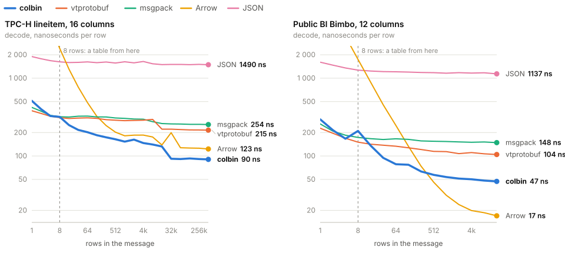
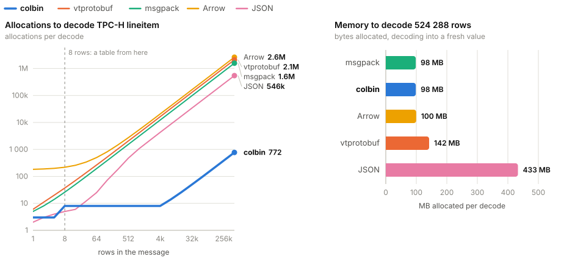

# Results

The results of the run the paper reports, in the order the paper gives them.
[README.md](README.md) has the method in brief and a one-screen summary; this
file has every table.

| | |
|---|---|
| run | [`results/paper-v1`](results/paper-v1) (cloud), [`results/paper-v1-laptop`](results/paper-v1-laptop) (second machine), [`results/paper-v1-sweep`](results/paper-v1-sweep) (the row sweep) |
| commit of this repository | `6084588` |
| colbin | v0.13.1 |
| Go | 1.27.4 |
| machine | AMD EPYC 7J13, Oracle Cloud container instances, one core per case |

This file is written by hand from those runs. The files it is written from
are the reference: each run's `SUMMARY.md`, and its `tables/` for the same
tables as LaTeX and every inline number (`tables/numbers.tex`).

- [How to read a table](#how-to-read-a-table)
- [By dataset](#by-dataset)
- [By kind of message](#by-kind-of-message)
- [Against the number of rows](#against-the-number-of-rows)
- [Access without decoding](#access-without-decoding)
- [What a decode allocates](#what-a-decode-allocates)
- [A second machine](#a-second-machine)
- [What a message is made of](#what-a-message-is-made-of)
- [Ablations](#ablations)
- [Repeatability and the control](#repeatability-and-the-control)
- [Where colbin loses](#where-colbin-loses)
- [What the evaluation does not cover](#what-the-evaluation-does-not-cover)

## How to read a table

Every table compares colbin with one other format on the cases both carry.

- **A cell is a factor.** 2.5× means colbin's message is 2.5 times smaller
  than the other format's, or that colbin is 2.5 times faster.
- **Below 1, in bold, the other format wins.** **0.80×** means the other
  format is 1.25 times smaller or faster.
- **The factor is a geometric mean** over the cases, of the two formats'
  ratio on each case. Every case weighs the same.
- **Between about 0.96× and 1.04× is a tie.** That is what two passes of the
  same measurement differ by ([Repeatability](#repeatability-and-the-control)).
- **Size** cells are `as written / under gzip 6`. **Time** cells are
  `encode / decode`, where encode is into a reused buffer and decode is into
  a fresh value.
- **n/a**: the format does not carry those cases. Arrow carries only roots
  that are tables.

The formats, by the name used in the tables:

| name | implementation | version |
|---|---|---|
| JSON | `encoding/json/v2` | Go 1.27.4 |
| gob | `encoding/gob` | Go 1.27.4 |
| CBOR | fxamacker/cbor | v2.9.6 |
| MessagePack, generated | tinylib/msgp | v1.6.5 |
| MessagePack, reflection | vmihailenco/msgpack | v5.4.1 |
| Protocol Buffers, vtprotobuf | planetscale/vtprotobuf (generated code) | v0.6.0 |
| Protocol Buffers, protobuf-go | protobuf-go (reflection) | v1.36.12 |
| FlatBuffers | google/flatbuffers | v25.12.19 |
| Arrow | apache/arrow-go, IPC stream | v18.8.0 |
| Avro | hamba/avro | v2.31.0 |
| Cap'n Proto | capnproto.org/go/capnp | v3.1.0-alpha.2 |
| colbin | ivanjoz/colbin | v0.13.1 |

The two implementations of Protocol Buffers write the same bytes, so the
size tables have one row for both. The two of MessagePack differ by a few
percent in size; the size tables give the generated one.

The cases reported are 107: 10 of TPC-H, 24 of TPC-DS, 46 of Public BI and
27 of SchemaStore, of which colbin carries 25. gob is timed on the cases it
round-trips: 40 of the 80 tables, and all the SchemaStore documents.

## By dataset

**Size**: times smaller than each format, `as written / under gzip`.

| colbin against | TPC-H | TPC-DS | Public BI | SchemaStore |
|---|---:|---:|---:|---:|
| JSON | 2.3× / 1.42× | 5.2× / 2.2× | 4.2× / 1.68× | 3.3× / 1.91× |
| gob | 1.22× / 1.34× | 1.96× / 2.1× | 1.33× / 1.36× | 5.6× / 3.0× |
| CBOR | 1.94× / 1.42× | 4.2× / 2.3× | 3.5× / 1.68× | 2.6× / 1.74× |
| MessagePack | 1.94× / 1.43× | 4.2× / 2.3× | 3.5× / 1.68× | 2.6× / 1.77× |
| Protocol Buffers | 1.16× / 1.34× | 1.56× / 1.91× | 1.35× / 1.42× | 1.09× / 1.03× |
| FlatBuffers | 1.69× / 1.70× | 3.4× / 2.8× | 1.95× / 1.69× | 3.0× / 1.71× |
| Arrow | 1.52× / 1.58× | 4.7× / 3.0× | 1.65× / 1.56× | n/a |
| Avro | 1.06× / 1.23× | 1.32× / 1.70× | 1.23× / 1.30× | **0.91×** / **0.94×** |
| Cap'n Proto | 1.69× / 1.58× | 3.3× / 2.3× | 2.1× / 1.71× | 3.2× / 1.52× |

**Time**: times faster than each format, `encode / decode`.

| colbin against | TPC-H | TPC-DS | Public BI | SchemaStore |
|---|---:|---:|---:|---:|
| JSON | 15.9× / 10.9× | 15.4× / 9.2× | 15.1× / 13.8× | 8.7× / 3.8× |
| gob | 8.5× / 5.6× | 13.0× / 7.8× | 8.5× / 5.0× | 35.6× / 49.9× |
| CBOR | 6.7× / 10.3× | 7.1× / 8.6× | 6.3× / 11.6× | 4.0× / 3.6× |
| MessagePack, generated | 1.29× / 2.1× | 1.21× / 1.68× | 1.30× / 2.7× | **0.66×** / **0.82×** |
| MessagePack, reflection | 11.0× / 9.2× | 12.6× / 8.2× | 9.7× / 10.4× | 7.9× / 3.9× |
| Protocol Buffers, vtprotobuf | 1.85× / 2.2× | 1.58× / 1.73× | 1.37× / 2.4× | **0.83×** / 1.03× |
| Protocol Buffers, protobuf-go | 5.2× / 3.7× | 4.5× / 2.5× | 4.1× / 2.9× | 2.2× / 1.68× |
| FlatBuffers | 4.6× / 1.91× | 8.5× / 1.72× | 5.9× / 2.4× | 2.8× / **0.80×** |
| Arrow | 7.1× / 1.93× | 12.5× / 2.8× | 3.9× / 1.78× | n/a |
| Avro | 3.0× / 2.4× | 2.9× / 3.2× | 2.5× / 4.9× | 2.5× / 1.19× |
| Cap'n Proto | 14.6× / 4.8× | 10.0× / 3.3× | 10.7× / 4.6× | 12.8× / 3.0× |

**Size.** On the three tabular datasets colbin is smaller than every other
format, as written and under gzip. Compression narrows the gaps against the
text and self-describing formats, because a general-purpose compressor
removes much of the redundancy a binary format removes by construction. On
tables it does not close them: the column transforms expose regularities
across rows that a byte-oriented compressor with a bounded window does not
find in a row layout. Against the compact row formats (Protocol Buffers,
Avro, gob) the gap is wider under gzip than as written.

On SchemaStore, whose documents hold no table, colbin is a row format, and
the three schema-driven formats do much the same thing: colbin is within a
tenth of Protocol Buffers and of Avro, a difference of a few bytes a
message.

**Time.** The formats to compare with are the ones with generated code,
vtprotobuf and generated MessagePack. The reflection-based implementations
of the same two formats are several times slower. That is the cost colbin,
which generates nothing, avoids by other means: a plan built once per type
and executed over raw pointers.

On the tabular datasets colbin encodes 1.4× to 1.9× faster than vtprotobuf
and decodes 1.7× to 2.4× faster. Decoding a column is a tight loop over one
type, where decoding rows dispatches on a tag per field. On SchemaStore it
loses to generated code: it encodes faster than generated MessagePack in 1
of 25 documents.

## By kind of message

The same cases, grouped by what a message is rather than where it comes
from:

- **Bulk tables** (14 cases): more than 16 384 rows.
- **Web tables** (66 cases): a slice of up to 16 384 rows, the bound this
  evaluation takes for one response to a web client.
- **Single records** (27 cases, of which colbin carries 25): one object with
  no table in it. These are the SchemaStore documents.

**Size**: times smaller, `as written / under gzip`.

| colbin against | bulk tables | web tables | single records |
|---|---:|---:|---:|
| JSON | 5.9× / 2.5× | 3.9× / 1.66× | 3.3× / 1.91× |
| gob | 1.79× / 2.1× | 1.42× / 1.44× | 5.6× / 3.0× |
| CBOR | 4.7× / 2.6× | 3.2× / 1.67× | 2.6× / 1.74× |
| MessagePack | 4.7× / 2.5× | 3.2× / 1.68× | 2.6× / 1.77× |
| Protocol Buffers | 1.74× / 2.3× | 1.32× / 1.41× | 1.09× / 1.03× |
| FlatBuffers | 3.4× / 3.2× | 2.1× / 1.77× | 3.0× / 1.71× |
| Arrow | 2.7× / 2.6× | 2.1× / 1.78× | n/a |
| Avro | 1.46× / 2.0× | 1.19× / 1.29× | **0.91×** / **0.94×** |
| Cap'n Proto | 3.5× / 2.8× | 2.2× / 1.71× | 3.2× / 1.52× |

**Time**: times faster, `encode / decode`.

| colbin against | bulk tables | web tables | single records |
|---|---:|---:|---:|
| JSON | 17.2× / 19.6× | 14.9× / 10.6× | 8.7× / 3.8× |
| gob | 6.5× / 5.0× | 11.6× / 6.6× | 35.6× / 49.9× |
| CBOR | 8.0× / 17.7× | 6.3× / 9.3× | 4.0× / 3.6× |
| MessagePack, generated | 1.47× / 3.0× | 1.23× / 2.1× | **0.66×** / **0.82×** |
| MessagePack, reflection | 12.0× / 16.1× | 10.4× / 8.5× | 7.9× / 3.9× |
| Protocol Buffers, vtprotobuf | 2.1× / 2.7× | 1.38× / 2.0× | **0.83×** / 1.03× |
| Protocol Buffers, protobuf-go | 5.4× / 4.5× | 4.1× / 2.6× | 2.2× / 1.68× |
| FlatBuffers | 10.3× / 2.8× | 5.8× / 1.96× | 2.8× / **0.80×** |
| Arrow | 3.4× / 1.62× | 6.7× / 2.2× | n/a |
| Avro | 3.0× / 5.3× | 2.6× / 3.7× | 2.5× / 1.19× |
| Cap'n Proto | 9.0× / 5.9× | 11.4× / 3.9× | 12.8× / 3.0× |

The results separate into the column layout's case and the row format's.

- **Bulk tables.** colbin is faster than every format on both operations
  in every case it shares with them: 14 of 14 against vtprotobuf.
- **Web tables** keep most of that advantage. Against vtprotobuf colbin
  encodes faster in 58 of 66 cases and decodes faster in 62.
- **Single records** are where colbin has no table to write. It is within a
  tenth of the other schema-driven formats on size. On time it loses to
  generated MessagePack on both operations and to vtprotobuf on encode, ties
  with vtprotobuf on decode, and decodes 1.25× slower than FlatBuffers.

## Against the number of rows

The two kinds of table differ from the single record in one thing above all,
the number of rows. colbin writes a slice of structs as a list of rows below
8 elements and as columns from 8 up.

**Across the cases.** colbin's decode against vtprotobuf's and JSON's, by the
rows of the message's root slice. Every case is another schema, so this
mixes the number of rows with what the rows hold.

| rows | cases | against vtprotobuf | against JSON |
|---|---:|---:|---:|
| 1 | 25 | 1.02× | 3.7× |
| 2 to 7 | 7 | 1.01× | 3.9× |
| 8 to 30 | 5 | 1.50× | 4.9× |
| 350 to 2 000 | 8 | 1.90× | 8.4× |
| 2 000 to 8 000 | 19 | 1.88× | 10.2× |
| 8 000 to 16 384 | 27 | 2.8× | 17.8× |
| over 16 384 | 14 | 2.7× | 19.6× |

No case has between 31 and 349 rows.

**One table, growing.** The sweep removes the schema from the comparison. It
takes one table, cuts it to its first 1, 2, 4, … rows and decodes each cut:
TPC-H's `lineitem` up to 2^19 rows and the Public BI sample `Bimbo` up to
2^14. It is a run of its own, on an instance of the same shape, at the same
commit and with the same colbin.

<picture>
  <source media="(prefers-color-scheme: dark)" srcset="docs/rows-time-dark.svg">
  
</picture>

Nanoseconds per row to decode into a fresh value:

| rows of `lineitem` | 1 | 4 | 8 | 16 | 64 | 512 | 16 384 | 524 288 |
|---|---:|---:|---:|---:|---:|---:|---:|---:|
| colbin | 512 | 326 | 318 | 249 | 202 | 164 | 132 | 90 |
| vtprotobuf | 381 | 324 | 311 | 303 | 309 | 288 | 221 | 215 |
| MessagePack, generated | 421 | 333 | 320 | 317 | 326 | 308 | 261 | 254 |
| Arrow | 17 958 | 4 660 | 2 419 | 1 307 | 484 | 202 | 138 | 123 |
| JSON | 1 899 | 1 680 | 1 622 | 1 587 | 1 620 | 1 565 | 1 496 | 1 490 |

| rows of `Bimbo` | 1 | 4 | 8 | 16 | 64 | 512 | 16 384 |
|---|---:|---:|---:|---:|---:|---:|---:|
| colbin | 296 | 166 | 210 | 136 | 78 | 57 | 47 |
| vtprotobuf | 227 | 169 | 151 | 142 | 133 | 115 | 104 |
| MessagePack, generated | 258 | 185 | 173 | 167 | 166 | 155 | 148 |
| Arrow | 13 733 | 3 447 | 1 743 | 890 | 247 | 46 | 17 |
| JSON | 1 606 | 1 354 | 1 269 | 1 236 | 1 208 | 1 177 | 1 137 |

- **Below 8 rows** colbin writes the rows one after another, as the
  row-oriented formats do, and costs about what they cost. At one row it is
  1.3× slower than vtprotobuf on both tables, and it draws level by four
  rows.
- **At 8 rows** the slice becomes a table, whose header and column
  descriptors are paid over only eight rows. On `Bimbo` the cost per row
  goes up at that point: 1.4× slower than vtprotobuf.
- **From 16 rows** the row-oriented formats' cost per row stays nearly flat
  while colbin's keeps falling. Against vtprotobuf on `lineitem` it is 1.2×
  faster at 16 rows, 1.5× at 64, 1.7× at 2^14 and 2.4× at 2^19. On `Bimbo`
  it is 1.7× at 64 and 2.2× at 2^14.
- **Against JSON** the factor goes from 3.7× at one row of `lineitem` to
  16.5× at 2^19, and from 5.4× to 24× on `Bimbo`.
- **Arrow**, a columnar format with a larger fixed cost, is far slower on
  small messages (colbin is 46× faster at one row of `Bimbo`) and keeps
  improving after colbin levels off. On `Bimbo` it overtakes colbin between
  256 and 512 rows, and at 2^14 rows it is 2.8× faster. On `lineitem` colbin
  stays ahead of it at every size, by 1.05× at its closest, at 2^14 rows.

The gain with rows is therefore the table's: a fixed cost that a row format
does not pay and that colbin recovers from a few tens of rows on.

## Access without decoding

The access operation is the sum of one numeric column computed from the
encoded bytes. It is defined for the 20 web cases and the 14 bulk cases that
have such a column. The numbers here are a fraction of a JSON decode of the
same case:

| | web | bulk |
|---|---:|---:|
| FlatBuffers | 0.013 | 0.0096 |
| Arrow | 0.072 | 0.00067 |
| colbin | 0.174 | 0.051 |

The zero-copy formats are in a class of their own: Arrow sums a contiguous
column in place. colbin has no access path that avoids decoding. Its numbers
are a full decode followed by the sum. An application that reads one field
of a large message and discards the rest is better served by those formats.

## What a decode allocates

Go's benchmark reports, beside the time of an operation, the bytes it
allocates and the number of allocations. Both are in the same samples the
times come from, and they do not depend on the clock.

<picture>
  <source media="(prefers-color-scheme: dark)" srcset="docs/rows-memory-dark.svg">
  
</picture>

Times fewer than each format to decode a message into a fresh value, as
`bytes / allocations`:

| colbin against | bulk tables | web tables | single records |
|---|---:|---:|---:|
| JSON | 3.4× / 932× | 1.79× / 198× | **0.85×** / 1.06× |
| gob | 3.2× / 2 196× | 2.9× / 208× | 64.5× / 60.5× |
| CBOR | 1.00× / 2 498× | **0.87×** / 311× | 1.06× / 1.92× |
| MessagePack, generated | 1.00× / 2 487× | **0.86×** / 303× | **0.90×** / 1.56× |
| MessagePack, reflection | 1.62× / 2 527× | 1.30× / 329× | 2.4× / 2.9× |
| Protocol Buffers, both | 1.45× / 3 276× | 1.08× / 380× | 2.5× / 2.4× |
| FlatBuffers | 1.12× / 3 186× | **0.91×** / 372× | **0.90×** / 1.58× |
| Arrow | 1.00× / 3 233× | 1.34× / 479× | n/a |
| Avro | 3.5× / 253× | 1.82× / 113× | **0.88×** / **0.70×** |
| Cap'n Proto | 1.00× / 2 488× | **0.92×** / 325× | 3.6× / 2.8× |

The two numbers tell different things.

- **Bytes.** colbin is close to the other formats, since every decoder has
  to hold the same data. Decoding 524 288 rows of `lineitem` allocates 98 MB
  with colbin, generated MessagePack or Arrow, 142 MB with vtprotobuf and
  433 MB with JSON.
- **Allocations.** A row format allocates as it meets each row and each
  string, so its allocations grow with the rows. colbin decodes a table
  column by column. Decoding `lineitem` takes it 8 allocations at any size
  from 8 to 4 096 rows and 772 at 524 288, where vtprotobuf takes 2.1
  million. No case of the evaluation, of up to 870 000 rows, takes colbin
  more than two thousand allocations to decode.
- **Single records.** With no columns, the advantage is of the size of the
  others in this file: 2.4× fewer allocations than vtprotobuf and 1.56×
  fewer than generated MessagePack, which in turn needs fewer bytes. Avro
  needs fewer of both.

Two cautions:

- These counts are of each library decoding into the type it decodes into.
  colbin, JSON and the reflection-based libraries fill the Go struct, and
  the code-generated ones fill their own generated types. Protocol Buffers'
  Go binding holds a repeated message as a slice of pointers, one
  allocation per row. Part of the gap on tables is that binding's
  representation rather than the wire format. It is what a Go program that
  uses the library pays.
- A row format's allocations come from strings and from rows behind
  pointers. On `Bimbo`, a table of numbers only, generated MessagePack
  decodes in 2 allocations at any size.

**Encode.** Allocations to encode a message into a reused buffer. A table of
factors would be mostly a ratio of two zeros, so these are counts:

| format | cases | cases with no allocation | median per encode | most |
|---|---:|---:|---:|---:|
| JSON | 107 | 0 | 4 | 68 |
| gob | 67 | 0 | 30 | 86 |
| CBOR | 107 | 0 | 1 | 27 |
| MessagePack, generated | 107 | 107 | 0 | 0 |
| MessagePack, reflection | 107 | 0 | 18 | 28 |
| Protocol Buffers, protobuf-go | 107 | 107 | 0 | 0 |
| Protocol Buffers, vtprotobuf | 107 | 107 | 0 | 0 |
| FlatBuffers | 107 | 34 | 1 | 7 |
| Arrow | 82 | 0 | 664 | 7 944 |
| Avro | 107 | 0 | 1 | 50 |
| Cap'n Proto | 105 | 0 | 6 | 24 |
| colbin | 105 | 89 | 0 | 9 |

Generated MessagePack and both implementations of Protocol Buffers allocate
nothing in any case. colbin does not reach that: it allocates nothing in 89
of its 105 cases and a few times in the others, all of them tables of more
than 2.5 MB encoded, though not every table of that size.

## A second machine

The same commit was measured again, in full, on a machine of another kind: a
Ryzen 7 5700U, a 15 W client processor of the same vendor and an earlier
microarchitecture (Zen 2 against the server's Zen 3), at about half the
clock, with a last-level cache of 4 MB. There the clock was fixed rather
than measured: boost off, the `performance` governor, and the measured cores
sharing their cache with nothing else. The two machines are never pooled.

The sizes do not depend on the machine, and they came out the same byte for
byte on both for every case reported here.

**Time**: times faster, `encode / decode`, cloud and then laptop.

| colbin against | | bulk tables | web tables | single records |
|---|---|---:|---:|---:|
| JSON | cloud | 17.2× / 19.6× | 14.9× / 10.6× | 8.7× / 3.8× |
| | laptop | 23.1× / 30.1× | 13.9× / 16.4× | 2.8× / 2.3× |
| Protocol Buffers, vtprotobuf | cloud | 2.1× / 2.7× | 1.38× / 2.0× | **0.83×** / 1.03× |
| | laptop | 1.96× / 3.4× | 1.29× / 2.4× | **0.92×** / 0.99× |
| MessagePack, generated | cloud | 1.47× / 3.0× | 1.23× / 2.1× | **0.66×** / **0.82×** |
| | laptop | 1.51× / 3.8× | 1.28× / 2.8× | **0.90×** / **0.91×** |
| Avro | cloud | 3.0× / 5.3× | 2.6× / 3.7× | 2.5× / 1.19× |
| | laptop | 3.2× / 6.2× | 2.3× / 5.1× | 1.28× / 0.99× |

The conclusions hold on both machines. On tables, bulk and of web size,
colbin encodes and decodes faster than each of the four formats on the
laptop as on the cloud. On single records it encodes slower than generated
code on both and decodes at vtprotobuf's speed on both.

What moves is the size of the margins, and not all one way:

- Against vtprotobuf, encode is slightly narrower on the laptop and decode
  is wider.
- On tables the laptop widens colbin's lead in decode over every format,
  JSON most of all.
- On single records everything is closer together on the laptop. colbin's
  lead over JSON and Avro is smaller there, and so is its deficit to encode
  against generated code.

The laptop's full tables are in
[`results/paper-v1-laptop/tables/`](results/paper-v1-laptop/tables).

## What a message is made of

colbin's messages by regime and dataset: the struct rows at any depth, how
many of them are written as table rows, and the schema section. The section
is not part of the message unless it is embedded.

| regime | dataset | cases | rows | rows in tables | schema section, median | section over message, median | bytes per value, median |
|---|---|---:|---:|---:|---:|---:|---:|
| web | TPC-H | 4 | 16 030 | 100.0% | 68 B | 1.33% | 19.91 |
| web | TPC-DS | 16 | 57 284 | 100.0% | 240 B | 8.39% | 8.53 |
| web | Public BI | 46 | 360 830 | 100.0% | 627 B | 0.04% | 7.07 |
| web | SchemaStore | 25 | 69 | 0.0% | 89 B | 177.78% | 9.00 |
| bulk | TPC-H | 6 | 2 467 746 | 100.0% | 162 B | 0.00% | 7.49 |
| bulk | TPC-DS | 8 | 1 118 886 | 100.0% | 309 B | 0.01% | 1.89 |

- The tabular datasets are tables almost entirely, by construction.
- SchemaStore's documents hold 69 struct rows in total and none of them in
  a table. On that dataset colbin is a row format, and its results there
  measure the row format alone.
- The schema section, when embedded, costs its size once per message. That
  is nearly free for a table (0.04% of a Public BI message) and more than
  doubles a small document (178% of a SchemaStore one, which is itself tens
  of bytes). A stream of small messages should send the section once per
  connection instead.

## Ablations

Two constants shape the table layout: the row count at which a slice becomes
a table, and the rule that picks a column's transform. The ablations use a
build of colbin in which both are variables (`colbin_ablation`). They
measure size only, since that build is not the one to time, and every
variant is checked to decode back to the original value.

**Threshold.** colbin's size with the threshold at 2, 4, 16 and 32 rows,
over its size at the default of 8, as written.

| regime | dataset | cases | 2 | 4 | 16 | 32 |
|---|---|---:|---:|---:|---:|---:|
| web | TPC-H | 4 | 0.997 | 0.997 | 1.000 | 1.010 |
| web | TPC-DS | 16 | 0.989 | 0.990 | 1.000 | 1.056 |
| web | Public BI | 46 | 1.000 | 1.000 | 1.000 | 1.000 |
| web | SchemaStore | 23 | 1.000 | 1.000 | 1.000 | 1.000 |
| bulk | TPC-H | 6 | 1.000 | 1.000 | 1.000 | 1.000 |
| bulk | TPC-DS | 8 | 1.000 | 1.000 | 1.000 | 1.000 |

The threshold matters only for slices near it, and its effect on size is
small. Only the web cases of TPC-H and TPC-DS move, the two datasets with
tables of fewer than 32 rows. Lowering the threshold to 2 or 4 writes their
shortest tables as columns and saves up to 1.1%. Raising it to 32 writes
tables of 8 to 31 rows as lists and costs up to 5.6%.

The threshold of eight is a design choice, not a tuned value: on size a
threshold of 2 or 4 is as good or slightly better on these cases, and the
ablation does not measure time. The sweep above shows the time side on one
table: at exactly 8 rows of `Bimbo` the table costs more per row than the
list did at 4.

**Column transform.** colbin's size with every integer column forced to one
transform, over its size with the transform chosen per column.

| regime | dataset | cases | raw | delta | frame of reference | raw, gzip | delta, gzip | frame of reference, gzip |
|---|---|---:|---:|---:|---:|---:|---:|---:|
| web | TPC-H | 4 | 1.004 | 1.001 | 1.006 | 1.020 | 1.002 | 1.028 |
| web | TPC-DS | 16 | 1.029 | 1.010 | 1.028 | 1.170 | 1.008 | 1.150 |
| web | Public BI | 46 | 1.081 | 1.074 | 1.067 | 1.065 | 1.069 | 1.045 |
| web | SchemaStore | 23 | 1.000 | 1.000 | 1.000 | 1.000 | 1.000 | 1.000 |
| bulk | TPC-H | 6 | 1.022 | 1.008 | 1.010 | 1.100 | 1.002 | 1.059 |
| bulk | TPC-DS | 8 | 1.264 | 1.035 | 1.109 | 1.899 | 1.002 | 1.661 |

The *raw* column is bit-packing alone, so it shows what the transforms are
worth at all.

- Without transforms a message is between 0.4% (TPC-H, web) and 26% (TPC-DS,
  bulk) larger as written. The gap widens under gzip, to 90% on bulk TPC-DS:
  the compressor does not recover what the transforms remove.
- Delta alone is the best single transform, at most 3.5% over the default
  as written everywhere but Public BI.
- On Public BI no single transform does better than 6.7% over the default.
  Real tables mix columns that want different transforms, which is what the
  choice per column is for.
- SchemaStore has no table and does not move.

**The other options**, in the web regime, as a fraction of JSON's size:

| variant | as written | under gzip |
|---|---:|---:|
| colbin, the default | 0.268 | 0.580 |
| colbin with `packed5` | 0.257 | 0.579 |
| colbin with the schema section embedded | 0.386 | 0.747 |

Packing strings at five bits a character saves bytes as written, but under
gzip the default is already there: compression does as well on plain text as
on packed text, and packing costs encode time (1.46× the default's). It is
off by default for that reason.

## Repeatability and the control

**The clock.** A container cannot fix the clock, so the harness measured it:
before every round of a case's samples it times a chain of dependent
multiplies on the measured core. Over the first web pass the clock was
between 3 166 and 3 198 MHz (5th and 95th percentiles). Within a case, the
slowest probe was within 0.9% of the fastest for the median case and within
3.2% for nine cases in ten. 5 of 93 cases saw the clock move by more than
5%. Samples are taken round-robin, so such a change falls on every format
of the case alike.

**Two passes.** The web cases were timed twice, several hours apart.

| | cloud | laptop |
|---|---:|---:|
| benchmarks compared | 3 980 | 3 980 |
| within 3% between the passes | 94.2% | 96.4% |
| median difference | 0.6% | 0.4% |
| largest change in a format's mean over colbin's | 0.8% | 0.5% |

Absolute times on the cloud are therefore not repeatable to 3%. Ratios
between formats are, to under 1%. That is why everything here is a ratio,
and why a difference under about 4% is read as no difference.

Each format's time over colbin's, as a geometric mean over the web cases
both have, in the two passes on the cloud:

| time over colbin's | encode, pass 1 | pass 2 | decode, pass 1 | pass 2 |
|---|---:|---:|---:|---:|
| JSON | 12.888 | 12.848 | 8.018 | 8.003 |
| gob | 19.150 | 19.074 | 16.271 | 16.264 |
| CBOR | 5.553 | 5.546 | 7.193 | 7.185 |
| MessagePack, generated | 1.038 | 1.034 | 1.631 | 1.624 |
| MessagePack, reflection | 9.603 | 9.579 | 6.903 | 6.885 |
| Protocol Buffers, protobuf-go | 3.483 | 3.482 | 2.316 | 2.313 |
| Protocol Buffers, vtprotobuf | 1.202 | 1.203 | 1.685 | 1.679 |
| FlatBuffers | 4.728 | 4.701 | 1.533 | 1.522 |
| Arrow | 7.426 | 7.403 | 2.311 | 2.295 |
| Avro | 2.586 | 2.576 | 2.725 | 2.710 |
| Cap'n Proto | 11.745 | 11.729 | 3.676 | 3.670 |
| colbin with `packed5` | 1.457 | 1.455 | 1.195 | 1.189 |
| colbin with the schema section | 1.856 | 1.851 | 1.041 | 1.040 |

This table pools web tables and single records, so its means are not those
of the tables above, which keep them apart.

**The A/A control.** Between two samples Go's runtime returns free heap to
the kernel, and the next benchmark that allocates pays to get it back. What
a decode into a fresh value costs would then depend on which benchmark ran
before it. Three measures keep that out of the numbers:

- The workers run with `GODEBUG=madvdontneed=0`, under which released memory
  costs nothing to take back.
- Every sample starts right after a collection.
- Every run carries a control. colbin and colbin with its schema section
  embedded share a decoder and decode the same rows, so on a table their
  times should match.

colbin's decode time over the self-describing variant's, as a geometric
mean:

| | cloud | laptop |
|---|---:|---:|
| bulk tables, decode into a fresh value | 1.02 | 1.01 |
| bulk tables, decode into a reused value | 1.01 | 1.00 |
| web tables, decode into a fresh value | 1.00 | 1.00 |
| web tables, decode into a reused value | 0.99 | 0.99 |

The control does not come out at exactly 1, and what is left has a
direction: on bulk tables colbin is the slower of the two in 14 of 14 cases
on the cloud and 11 of 14 on the laptop. A cost of position of one to two
percent therefore remains in decode-fresh on bulk tables, against colbin. It
is inside the band of 4% below which nothing here is read as a difference.

## Where colbin loses

- **Single records, against Avro.** With no table, colbin is a row format
  with one byte of header per field. Avro writes no header at all and is
  smaller: colbin is smaller in 10 of 25 documents under gzip. Avro pays for
  this with a reader that must have the writer's exact schema.
- **Time on single records, against generated code.** Generated MessagePack
  encodes 1.5× faster and decodes 1.2× faster, vtprotobuf encodes 1.2×
  faster and FlatBuffers decodes 1.25× faster. Straight-line generated code
  beats a plan interpreted per field on a message of a few fields.
- **Access without decoding.** colbin must decode a message to read one
  field of it. Arrow and FlatBuffers read a column in place and are faster
  at it by orders of magnitude.
- **Large numeric tables, against Arrow.** On `Bimbo`, Arrow decodes faster
  than colbin from about 512 rows.
- **Data with nothing to exploit.** A column of random 64-bit values costs
  its eight bytes a value plus a width byte per block, and strings are not
  compressed at all by the default format. A table that is mostly long,
  distinct strings is the size of its strings in any format.
- **SchemaStore as `map[string]any`.** The run also measures each document
  with no Go type. Only the schemaless formats and Protocol Buffers can
  carry that, so it is not in these tables, and colbin lost there on time
  ([datasets/README.md](datasets/README.md), subset history 5).

## What the evaluation does not cover

- **The author evaluates his own format.** The format, the harness and the
  choices are one person's. The data is third-party, the Go types of the 80
  tables are generated from the sources' `CREATE TABLE` statements, and
  every other format's schema is generated from those same types. Each
  library is called with its default options, through the interface its
  documentation gives for a hot path.
- **Two choices favour colbin.** Decimals and money are integer minor units
  and dates are integer days, which puts most values where an integer codec
  works. And the libraries, one or two per format, were chosen by the author
  as the ones in common use in Go.
- **One language.** All measurements are of Go implementations. A format's
  speed is its implementation's: the two implementations of Protocol Buffers
  and of MessagePack differ by more than most pairs of formats do. The sizes
  carry over to other languages; the times do not.
- **Two machines, both x86-64 and both AMD.** No Intel processor and no
  arm64 machine was measured, and two machines are not a population.
- **Synthetic distributions.** TPC-H and TPC-DS draw values from
  near-uniform distributions, which under-represent the skew and correlation
  of real data. They are reported per dataset so that Public BI, which is
  real, can be read on its own.
- **Hand-written types for SchemaStore.** The Go structs for its 27
  documents were written by the author, from the corpus's Protocol Buffers
  schemas. Two documents cannot be given a type colbin carries and are
  reported as not applicable.
- **Not measured.** The first use of a type, when the encoding plan is
  built: every time here is of a warmed-up process. What a process holds, as
  opposed to what an operation allocates. The time of compression. The cost
  of schema evolution.
- **colbin is before 1.0**, with no compatibility promise between minor
  versions. The numbers are for v0.13.1.

[README.md](README.md#known-gaps) lists the gaps of the artifact itself: gob's
coverage and sizes, zero-byte messages, and map order on the dynamic path.
