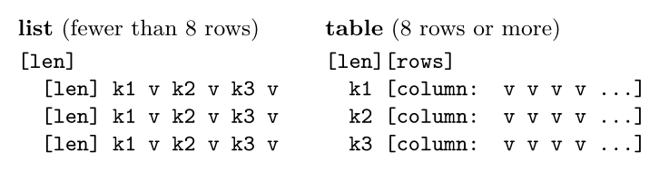
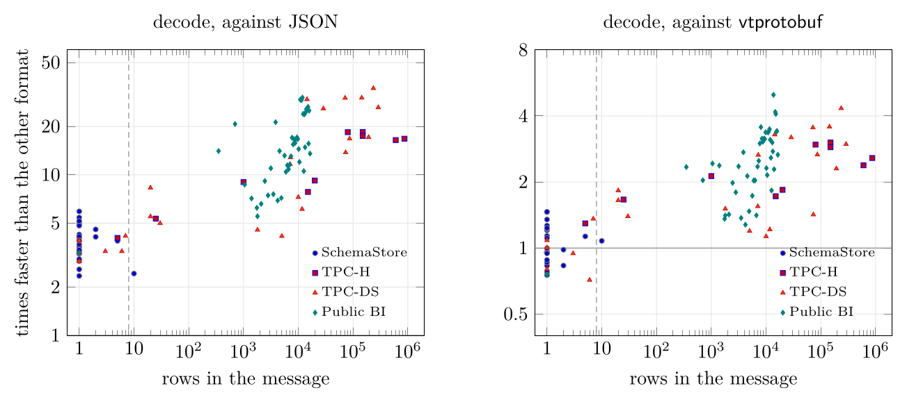
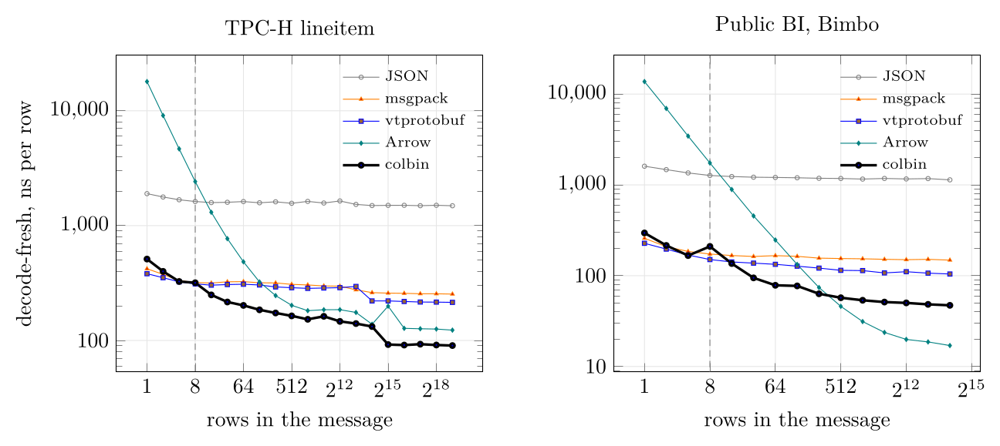
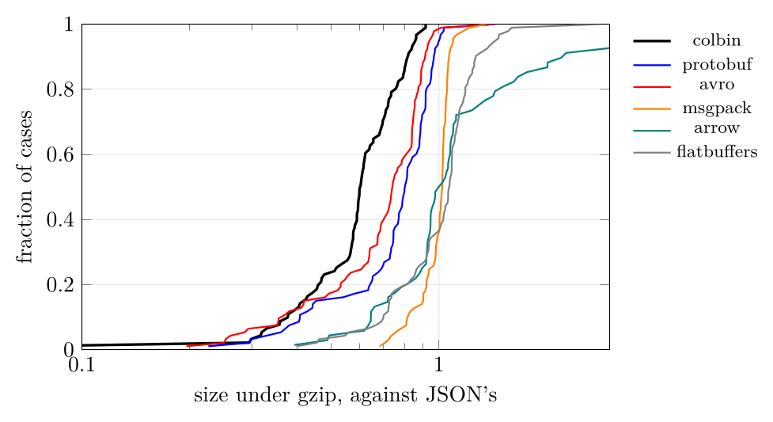
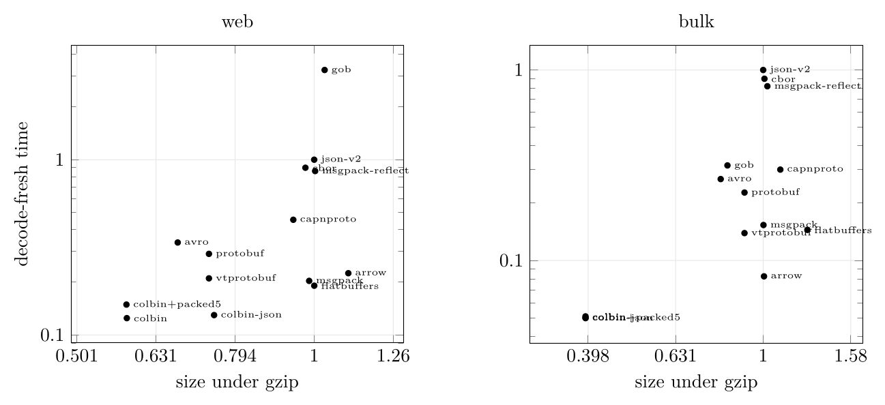

# colbin: a compact, hybrid row-columnar serialization format with a self-describing mode

Ivan Joseph Angulo Reyna  
Independent Researcher, Peru  
[`ivan@un.pe`](mailto:ivan@un.pe)

## Abstract

Serialization formats for messages encode a list of records row by row, repeating a field name (JSON) or a tag (Protocol Buffers, MessagePack, CBOR) in every record. Columnar formats remove that repetition, but they are built for files and analytical batches, with schemas and metadata that outweigh a small message. colbin is a hybrid binary serialization format: a message is written in a row format with one-byte field headers, and inside it each collection of eight or more records is written column by column, each integer column through a per-column transform and bit-packing in byte-aligned blocks of 128 values, a choice made per value when encoding. colbin needs no build step: the Go struct is the schema, with no interface description file, no schema compiler and no generated code. A message can embed its schema, a median of 68 to 627 bytes by dataset, and is then self-describing: any reader renders it as JSON without the producer’s type. We evaluate colbin against 11 other formats and implementations in Go on 107 cases from TPC-H, TPC-DS, the Public BI Benchmark and the SchemaStore corpus, on two machines. Compared with Protocol Buffers with the code generated by vtprotobuf, colbin, which generates none, is 1.41× smaller under gzip (1.32× as written), encodes 1.38× faster and decodes 2.0× faster on collections of up to 214 records, the size a web client receives, and 2.3× (1.74×), 2.1× and 2.7× on larger ones. On single records, where there are no columns to write, it is the same size under gzip (1.03×), decodes at the same speed (1.03×) and is 1.20× worse to encode. Against JSON, both under gzip, the collections of web size are 1.66× smaller (3.9× as written) and decode 10.6× faster. The format is built for collections and stays close to generated code on single records, where Avro is smaller and generated MessagePack is faster; Arrow and FlatBuffers read a field without decoding, which colbin does not.

## 1 Introduction

A response from a server to a client is, more often than not, a list of records: the rows of a report, the products of a catalogue page, the events of a time window. JSON \[8\] writes such a list with every field name in every record and every number as decimal text. The binary formats that replace it in practice, Protocol Buffers \[15\], MessagePack \[22\] and CBOR \[7\], remove the names or shorten them, and write numbers in binary, but they keep the row-by-row layout: a thousand records carry a thousand copies of each field’s tag, and values of one field, which resemble each other, are separated by values of the others, which do not.

Columnar formats solved this for analytical storage long ago. Storing the values of one column together removes the per-row tags, and lets each column be encoded with lightweight transforms such as delta, frame of reference and bit-packing \[37, 18\], as Parquet \[6\] and, more recently, BtrBlocks \[17\] and FastLanes \[1\] do for files, and as Arrow \[4\] does for in-memory interchange without compression. These formats are designed for tables of millions of rows. Their framing, schema and metadata are a fixed cost that a message of a few hundred bytes cannot absorb, they do not carry a document that is not a table, and they come with a schema language or a builder API that the application’s own types have to be mapped to.

This paper presents colbin, a *hybrid* serialization format: a message is written in a row format, and the columnar layout is applied inside it, where it pays, and nowhere else. The unit of decision is the value, at encode time: a slice of structs whose fields are scalars or strings is written as a list of rows when it is short, and as a table of columns from eight rows up. The rest of the message, the fields of the root, nested structs and maps, uses the row format, with one-byte field headers and no variable-length integers. A three-field configuration document and a million-row table are therefore the same format, and the encoder needs no hint about which it is writing. The two halves are evaluated apart: the single records of the evaluation measure the row format alone, and the collections measure the columns.

The second design constraint is setup cost. The schema of a colbin message is the Go struct itself: field numbers come from optional struct tags or are derived from field names, there is no interface description file, no compiler step and no generated type. This is the niche of Go’s gob \[28, 25\], and the reason a format with the size of a schema-compiled one is worth having without the compilation. A message can also carry its schema, in which case any reader renders it as JSON with no type at hand.

**What it is used for.** colbin is a general-purpose format: any place where Protocol Buffers or MessagePack would serve is a candidate. It was built for one application, a business system developed by the author, and its design follows the places where that system had JSON. They are of three kinds, and the evaluation is organised by them.

- *Bulk tables*: archives and backups of whole tables, written once and read rarely, where size is the cost.

- *Tables of web size*: the responses a server sends to a web client, a page of records at a time, and the cache of those responses.

- *Single records*: a record stored as one binary value in a key-value store, in place of a JSON document or one attribute per field, a small object stored in a binary column of a relational table, where a JSON or text column would otherwise hold it, and a message between two services.

The row format’s narrow field header, one byte for a type of up to sixteen fields (Section 2), exists for the last kind: the small objects that end up as a field of a larger record are, in a database, usually a JSON string, and most of such a string is field names and punctuation. A format that is to replace JSON in all three places has to be cheap for an object of three fields and compact for a table of a million rows, which is the choice per value described above.

**Contributions.**

- A hybrid message format in which a slice of structs is a list of rows or a columnar table, decided per value, with integer columns encoded by a per-column transform and bit-packed in byte-aligned blocks of 128 values, and float columns encoded as decimals where they are decimals (Section 2).

- A row format for everything that is not a table: one byte of header per field for types of up to sixteen fields, zero values not written, and every size read with a single load rather than a variable-length loop.

- A self-describing mode: a message can embed its schema, a key, a name and an operation code per field, and any reader then renders it as JSON, or decodes it into another type by field name, without the producer’s type. Its cost is measured against the message it describes (Section 5.7).

- An evaluation in Go against 11 formats and implementations (JSON, gob, CBOR, MessagePack, Protocol Buffers with two implementations, FlatBuffers, Arrow IPC, Avro and Cap’n Proto), raw and under gzip and Zstandard, on 107 cases from four public sources, none of them designed by the author (Sections 4 and 5).

- Ablations of the two parameters the layout rests on: the row count at which a slice becomes a table, and the choice of column transform (Section 5.8).

- An account of where the format loses or ties, and of what the evaluation does not cover (Section 6).

- A reproducible artifact: datasets pinned by checksum, the exact subset rules, and one command that regenerates every table and figure of this paper (Section 8).

The evaluation compares colbin with each other format directly, on the cases both carry, and reports the comparison two ways: by dataset, and by the three kinds of message above. A response to a web client bounds the size of a message, so a table of web size is one of at most 214 rows and a bulk table one past that bound; a single record is a document that holds no table.

## 2 The format

This section describes the wire format at the level the evaluation needs. The byte-level specification, and the measurements behind each decision, are in the library’s repository (Section 8).

### 2.1 Messages are key runs

A message is a *key run*: a sequence of fields, each a key, a descriptor and a payload, ended by the length of whatever encloses it. A run uses one of two key widths, chosen per struct type and recorded where the run opens. In the narrow width a field header is a single byte, four bits of key and four of descriptor, which covers types whose field numbers are 1 to 16. In the wide width it is two bytes, eight bits each, for numbers up to 255; a type with more fields is split into linked pages of 255. A nested struct opens its own run, so narrow and wide types nest in either order. In both widths the descriptor is enough to step over a field the reader does not know, so producer and consumer can add and drop fields independently.

Field numbers come from a struct tag (`cb:"3"`) or, without one, from an 8-bit hash of the field’s name with linear probing on collision. Untagged types therefore always use the wide width and cost one more byte per field present, and are limited to 255 fields. Tags are optional; every type in the evaluation has them.

### 2.2 Scalars

A field holding its type’s zero value is not written. An integer is written as sign and magnitude in the fewest bytes that hold it, one to eight, with the byte count in the descriptor; in the narrow width, the values the descriptor itself can name (1 to 4, or 1 to 3 and −1 for a signed field) need no payload, so a boolean or a small enumeration is one byte with its key. A string of up to eight bytes takes its size from the descriptor; a longer one carries a length of one, three or five bytes.

No size anywhere in the format is a variable-length integer. Protocol Buffers’ varints are compact, but each is decoded by a loop whose trip count is data, a cost that byte-oriented schemes such as Stream VByte \[19\] exist to avoid. In colbin every read of a size is one load of a width the header has already given.

A scalar floating-point field is written as its IEEE 754 bit pattern with the bytes reversed, in the unsigned integer form. The zero bytes of a float are its low mantissa bytes, where an integer’s are its high ones, so the trim that shortens an integer shortens a round float too: `1.0` is two bytes.

### 2.3 Composites, lists and tables

A nested struct, a list, a table or a map is written with its byte length in front, patched in after the body is written, which is what lets a reader skip it whole. A nil pointer is omitted; a pointer to a zero value is the one case in which the format writes a zero, to keep the two apart.

A slice of structs is written in one of two layouts (Figure 1):

- as a *list*, each element its own key run, when it has fewer than eight elements, or when the element type holds something that is not a column (a map, a nested struct, a slice of scalars);

- as a *table*, when it has at least eight elements and every field of the element type is a boolean, an integer, a float, a string, a pointer to one of those, or itself a slice of structs that qualifies.

The decision is taken per value at encode time, and the two layouts have different descriptors, so a reader dispatches on what it finds and neither side is configured. A table writes one key per column instead of one per field per row. A nullable column (a pointer field, which is how a Go type says a value may be absent) carries one bit of presence per row and the values of the rows present only, so the column codec sees real values and a run of nulls costs a bit a row; a column whose values are all zero, or all null, is not written at all. A table of more than 4 096 rows is written in groups of 4 096 rows, each group a complete set of columns, which bounds the memory the encoder transposes through and keeps a group’s columns in cache. The threshold of eight rows is the subject of the first ablation in Section 5.8.

**Figure 1:** The two layouts of a slice of structs with three fields. A list repeats each key in every row; a table writes each key once and its values together, where a column transform can use what they have in common.

### 2.4 The column codec

An integer column (and a boolean, date or timestamp column, which are integer columns) is one transform followed by blocks of bit-packed residuals:

- *raw*: the values, zigzag-encoded if any is negative;

- *delta*: differences between consecutive values, zigzag-encoded, after the first value;

- *frame of reference*: each value minus the column’s minimum \[37\];

- *constant*: the single value, and no blocks.

The encoder scores each candidate by the bytes its blocks would occupy and keeps the smallest. Residuals are then packed in blocks of 128 values, each block at its own bit width, written in one byte ahead of it. The block size is that of SIMD-BP128 \[18\], and it is chosen for the same arithmetic: 128 values of *w* bits are exactly 16*w* bytes, so every block starts and ends on a byte boundary, no state crosses from one block to the next, and one outlier widens 128 values rather than the column. A block of zeros has width 0 and costs one byte. Unpacking is one unaligned 8-byte load, a shift and a mask per value for widths up to 57 bits, with the width switched on once per block; there is no patching of exceptions as in PFOR. The second ablation in Section 5.8 forces each transform in turn.

A column of 64-bit floats whose values are decimals, as most floats that came out of a database or a CSV file are, is written as integers: the encoder looks for one exponent *e* per column such that *v* ⋅ 10*e* is an integer that converts back to *v* exactly, writes those integers through the integer codec, and keeps the values that do not fit as exceptions with their position and bit pattern. This is the decimal half of ALP \[2\] with one exponent per column and a division on decode rather than a multiplication by the inverse, which is slower but exact on every platform. The column is written this way only when it is smaller than the bit patterns would be.

String columns are written as the strings one after another, each with its size; they are not dictionary-coded.

### 2.5 Optional parts

**The schema section.** The wire carries no names and no types. A *schema section*, the type’s encoding plan serialized as a key, a name and an operation code per field, can be sent once per connection, or embedded at the front of a message. With it embedded, the message is self-describing: it can be rendered as JSON, or decoded into a different type by matching field names, with no knowledge of the producer’s type. The evaluation measures this mode as colbin-json, and reports the size of the section against the message in Section 5.7.

**Dynamic values.** A field of an open type (Go’s `any`, `[]any`, `map[string]any`) is written with a type descriptor per value, as schemaless formats do. No case of the evaluation uses this path.

**packed5.** An opt-in encoding packs strings of letters and digits at about five bits per character, when that is shorter. It is off by default and reported as a separate variant, colbin+packed5.

### 2.6 Schema evolution

The writer’s type and the reader’s need not be the same type. A field is found by its key, and a key the reader does not know is stepped over by its descriptor, so a field can be added or removed on either side: the reader of an older message finds the new field at its zero value, and the reader of a newer one skips what it does not know. The same holds for a column of a table, which is one key for all its rows. With tags the key is the tag, so a field can be renamed freely; without them the key is a hash of the name, and a renamed field is another field. An integer is written by its value, not by its declared width, so a field can be widened (an `int32` read as an `int64`) or narrowed, as long as the values fit.

Table 1 sets this beside the two formats the evaluation compares colbin with most closely. It is close to Protocol Buffers’ rules \[15\], with tags in the place of field numbers, and with two differences against colbin. A value that does not fit the reader’s narrower integer is an error in a record but is truncated without one in a column, where the check is not made per value. And a change of kind, an integer to a float or to a string, is not supported and is not always detected: the reader may return a wrong value instead of an error. Protocol Buffers also keeps the unknown fields of a message it decodes and writes again; colbin drops them. The behaviour of colbin in the table is checked by a test in the artifact (`formats/evolution_test.go`); that of the other two is their documentation’s, and for MessagePack’s integers the same test.

| change | colbin | Protocol Buffers | MessagePack (generated, keyed by name) |
|:---|:---|:---|:---|
| a field or a column added or removed | compatible both ways | compatible both ways | compatible both ways |
| a field renamed | compatible with tags; another field without | compatible | another field, unless a tag keeps the name |
| an integer widened | compatible | compatible | compatible |
| an integer narrowed, a value out of range | error in a record; truncated in a column | truncated | error |
| a change of kind (integer to float or string) | not supported, not always detected | not compatible | error |

**Table 1:** What a reader sees when its type is not the writer’s. *Compatible both ways*: an old reader decodes a new message and a new reader an old one, with the missing field at its zero value.

### 2.7 Implementation

The Go implementation has no dependencies. It builds an encoding plan per type on first use, by reflection, and then runs it over unsafe pointers, so the steady state involves no reflection except for maps. The hot loops of the column codec have assembly kernels on amd64 and arm64. Decoders treat their input as hostile: every length, count and row total is bounded before anything is allocated. Implementations in Rust and in JavaScript (through WebAssembly) read and write the same bytes; this paper evaluates the Go implementation only.

## 3 Related work

**Serialization formats.** The formats colbin is compared with fall in three groups. Schemaless formats, MessagePack \[22\] and CBOR \[7\], are binary JSON: they keep field names in every record. Schema-driven row formats, Protocol Buffers \[15\] and Avro \[5\], remove the names; Protocol Buffers keeps a tag per field, which makes fields optional and skippable, and Avro keeps nothing, which makes it the smallest row format and ties reader and writer to the same schema. Zero-copy formats, FlatBuffers \[14\] and Cap’n Proto \[31\], lay a message out so that a field is read in place, at the price of fixed-width fields and alignment. Go’s gob \[28, 25\] is the format closest to colbin in how it is used: it takes its schema from the Go type and needs no compilation, and it sends type descriptions in the stream. All of these write a list of records row by row.

**Benchmarks of serialization formats.** Viotti and Kinderkhedia survey JSON-compatible binary formats \[34\] and benchmark their sizes on 27 real documents taken from SchemaStore \[32, 27\], later extended to JSON BinPack \[33\]. We use their corpus unchanged, as the representative of small, heterogeneous documents, where a columnar layout has nothing to work with. Their study measures size only; we add encode and decode time. HyperProtoBench \[16\] characterises Protocol Buffers workloads at a large operator and motivates hardware acceleration of varint and field decoding, the per-field costs that colbin’s fixed-width sizes are meant to avoid in software.

**Lightweight integer compression.** The column codec belongs to the family of frame-of-reference and bit-packing schemes. PFOR and PFOR-DELTA \[37\] introduced patched frame of reference with decoding loops free of data-dependent branches. Lemire and Boytsov \[18\] showed that bit-packing blocks of 128 integers at one width per block decodes at billions of integers per second with SIMD; colbin uses their block size and its byte alignment, without exceptions and with scalar unpacking. Stream VByte \[19\] addresses the cost of variable-length integers by separating control bytes from data; colbin avoids such integers altogether. FastLanes \[1\] goes further than any of these with a layout that auto-vectorizes across instruction sets. colbin’s codec is deliberately simpler than the state of the art: it has to pay for itself on a column of eight values as well as on one of a million.

**Floating-point compression.** Gorilla \[24\] and Chimp \[20\] XOR consecutive values of a time series. ALP \[2\] observes that most doubles in real data are decimals and encodes them as integers. colbin adopts ALP’s decimal encoding in a reduced form (Section 2.4).

**Columnar formats and nested data.** Dremel \[21\] showed how to shred nested records into columns with repetition and definition levels, the basis of Parquet \[6\]. Arrow \[4\] defines a columnar memory layout and an IPC stream for it. BtrBlocks \[17\] selects among cascades of lightweight encodings per column block by sampling, and Zeng et al. \[36\] evaluate Parquet and ORC and find their encodings dated against such schemes. JSON Tiles \[12\] extracts columnar structure from collections of JSON documents inside a database. These systems target storage and analytics: data at rest, read many times, in files whose footers and dictionaries are amortised over millions of rows. colbin targets a message produced once and read once, usually small, in which a table is one field among others; it does not shred nested records, but lets a row hold a list column whose elements are again rows. Mixing the two layouts is not new in storage: PAX \[3\] keeps a relation in row pages and lays each page out by column. There the mix is fixed by the storage layout; in colbin it is decided per value while a message is encoded, and a message with no collection in it has no columnar part at all.

**Benchmark data.** TPC-H \[29\] and TPC-DS \[30, 23\] are generated from near-uniform distributions, and Vogelsgesang et al. \[35\] show how poorly such data represents real workloads for encodings. The Public BI Benchmark \[10, 13\], derived from real Tableau workbooks, is the corrective used in the compression literature, including by BtrBlocks and ALP, and it is here as well.

## 4 Methodology

### 4.1 What is evaluated

colbin is evaluated as a serialization format in Go: the bytes a Go program writes and reads, against the Go implementations of the other formats. One of its uses is a server’s response to a web client in place of JSON, but decoding in a browser is a different implementation and is outside this paper; nothing here should be read as a claim about it.

### 4.2 Datasets

All data is public and none of it was designed for this evaluation. Nothing downloaded is stored in the repository: each dataset has a script that downloads or generates it and checks every file against a manifest of SHA-256 checksums before anything reads it.

TPC-H  
 \[29\] at scale factor 0.1, generated by `dbgen` 2.17.3: all eight tables, each as a case, and two composite cases, the whole schema as one message (*normalized*) and orders with their line items nested inside them (*nested*), the only parent and child the schema has.

TPC-DS  
 \[30\] at scale factor 0.1: all 24 tables, one case each.

Public BI Benchmark  
 \[10\]: the first table of each of the 46 workbooks, and from each a seeded uniform random sample whose size depends on the table’s place in the list: 350 rows of the first table by name, 700 of the second, and so on in steps of 350 up to 15 750 for the 45th, and the regime’s bound of 214 for the last; or the whole table where it is shorter (two tables, of 1 795 rows and of one row).

SchemaStore  
 \[27\]: the 27 documents of Viotti and Kinderkhedia’s corpus \[32\], each through a Go struct.

**How the subsets are chosen.** Each subset follows a rule fixed in the repository (`datasets/README.md`), not a selection of tables or rows. For TPC-H and TPC-DS the rule is everything at one scale factor; scale factor 0.1 is about 100 MB of text per benchmark, which every format holds in memory at once, and a larger scale would add rows to the bulk regime only. For Public BI the rule is the first table of every workbook, so that no workbook weighs more than another; in 38 of the 46 workbooks it is the only table or the others share its schema. The sizes are staggered so that the tables of web size cover the whole range a response has, from a page of a few hundred records to the regime’s bound, rather than all sitting at that bound, where a columnar layout is at its best; which table gets which size is decided by its name alone. The rows are a random sample rather than the head of the file because these tables are often sorted by their leading columns, so the head repeats values more than the table does, which would flatter every format that exploits repetition, colbin most of all. The sample depends only on fixed seeds, the table’s name and the row index, and keeps table order: the dataset’s script draws 214 rows of each table, and the case keeps a second, independent draw of those. For SchemaStore the selection is that of the corpus’s authors.

**Go types.** Every format is driven from one Go struct per dataset root, written as a Go programmer would write it and not as any format prefers: the narrowest integer type that holds the column per the source’s schema, money and decimals as integer minor units, dates as integer days, a float only where the source has a float, and a pointer for a nullable column. The schemas of the other formats (`.proto`, FlatBuffers, Cap’n Proto and Avro schemas, generated MessagePack code, Arrow builders) are generated from those structs. For TPC-H, TPC-DS and Public BI the structs themselves are generated from the sources’ `CREATE TABLE` statements. For SchemaStore they were written by hand, from the Protocol Buffers schemas the corpus provides; this is a place where the author’s judgement enters (Section 6).

### 4.3 Kinds of message

We take 214 rows as the bound of what a server sends to a web client in one response; the bound is a convention of this paper, not a measurement. Every case falls in one of two regimes by its row count alone: *web*, at most 214 = 16 384 rows, and *bulk*, more than that. The web regime has 93 cases: the 46 Public BI samples, the 27 SchemaStore documents, 16 TPC-DS tables and 4 TPC-H tables. The bulk regime has 14: the other 8 TPC-DS tables, and for TPC-H four tables and the two composite cases. The web regime holds two kinds of message that a format treats differently, and the results keep them apart: a *web table*, a slice of rows (TPC-H, TPC-DS and Public BI; 66 cases), and a *single record*, one object with no table in it (SchemaStore; 27). With *bulk* (14), these are the three kinds of message the results are reported by, beside the four datasets, and the three uses the format was built for (Section 1). SchemaStore’s documents are configuration files, not database records; they stand in for the single record as the public corpus of small typed objects the evaluation could use.

### 4.4 Baselines

Table 2 lists the formats, their Go implementations and the versions measured. Two formats appear with two implementations, because the implementation moves the time by more than the format does: Protocol Buffers with the reflection-based protobuf-go and with the generated code of vtprotobuf \[26\], and MessagePack with generated code and with reflection. colbin appears as three variants: the default (colbin), with packed5 on, and self-describing with its schema section embedded (colbin-json). Only colbin, the default, is the result of this paper; the others isolate one option each.

| format          | implementation                   | version                |
|:----------------|:---------------------------------|:-----------------------|
| json-v2         | encoding/json/v2                 | Go 1.27.4              |
| gob             | encoding/gob                     | Go 1.27.4              |
| cbor            | fxamacker/cbor                   | v2.9.6                 |
| msgpack         | tinylib/msgp (generated code)    | v1.6.5                 |
| msgpack-reflect | vmihailenco/msgpack (reflection) | v5.4.1                 |
| protobuf        | protobuf-go                      | v1.36.12               |
| vtprotobuf      | planetscale/vtprotobuf           | v0.6.0                 |
| flatbuffers     | google/flatbuffers               | v25.12.19+incompatible |
| arrow           | apache/arrow-go (IPC stream)     | v18.8.0                |
| avro            | hamba/avro                       | v2.31.0                |
| capnproto       | capnproto.org/go/capnp           | v3.1.0-alpha.2         |
| colbin          | ivanjoz/colbin                   | v0.13.1                |
| gzip (level 6)  | compress/gzip                    | Go 1.27.4              |
| zstd (level 6)  | klauspost/compress               | v1.19.2                |

**Table 2:** Formats, implementations and versions. The versions are those pinned by the artifact’s `go.mod`; colbin’s is the one the run recorded.

Not every format carries every case, and a format that cannot carry a case is reported as not applicable, with the reason, rather than forced or silently dropped (Table 3). Arrow carries only roots that are tables. colbin itself cannot carry 2 of the 27 SchemaStore documents: it refuses a struct with no field it can encode, and in those documents a type has none. Cap’n Proto does not carry two SchemaStore documents, in which a field’s name collides with a method its Go code generator emits. gob does not transmit a pointer to a zero value, so it does not round-trip any table with a nullable column that holds a zero; its sizes on those cases are reported, flagged as lossy, and it is not timed on them (Section 6).

| format | web round-trips | web lossy | web n/a | bulk round-trips | bulk lossy | bulk n/a |
|:---|---:|---:|---:|---:|---:|---:|
| json-v2 | 93 | 0 | 0 | 14 | 0 | 0 |
| gob | 58 | 35 | 0 | 9 | 5 | 0 |
| cbor | 93 | 0 | 0 | 14 | 0 | 0 |
| msgpack | 93 | 0 | 0 | 14 | 0 | 0 |
| msgpack-reflect | 93 | 0 | 0 | 14 | 0 | 0 |
| protobuf | 93 | 0 | 0 | 14 | 0 | 0 |
| vtprotobuf | 93 | 0 | 0 | 14 | 0 | 0 |
| flatbuffers | 93 | 0 | 0 | 14 | 0 | 0 |
| arrow | 68 | 0 | 25 | 14 | 0 | 0 |
| avro | 93 | 0 | 0 | 14 | 0 | 0 |
| capnproto | 91 | 0 | 2 | 14 | 0 | 0 |
| colbin | 91 | 0 | 2 | 14 | 0 | 0 |
| colbin+packed5 | 91 | 0 | 2 | 14 | 0 | 0 |
| colbin-json | 91 | 0 | 2 | 14 | 0 | 0 |

**Table 3:** Cases per format and regime: round-tripped exactly, encoded but not round-tripped (lossy; sized, not timed), and not applicable.

### 4.5 What is measured

**Correctness first.** Before a size or a time is recorded, each format encodes the case, decodes it, and the result is compared with the original value by deep equality; where a case has an access aggregate, each format’s result is compared with the one computed on the Go value. A format that fails a check on a case has no time for it.

**Size.** The encoded message in bytes, as written and under two general-purpose compressors at level 6: gzip \[11\], which every browser accepts and every server can apply to a response on the fly, and Zstandard \[9\]. The text and the figures quote gzip unless they say “as written”; the tables give both. Compressed sizes matter because the realistic alternative to a binary format on the web is not JSON but compressed JSON.

**Time.** Four operations per format and case: *encode* into a reused buffer; *decode-fresh*, into a value allocated for the call; *decode-reuse*, into one value held across calls, which lets a decoder reuse its allocations; and *access*, the sum of one numeric column computed from the encoded bytes, in place where the format allows it (Arrow, FlatBuffers, Cap’n Proto) and by decoding first where it does not. Access is defined for the cases that have such a column (20 of the web cases and 14 of the bulk cases). For code-generated formats, converting between the format’s own types and the Go struct is outside the timed region.

**Protocol.** Each case runs in its own process, pinned to one hardware thread of a physical core with `taskset` and `GOMAXPROCS=1`; the garbage collector is at its default setting, and the runtime releases free memory to the kernel lazily (`GODEBUG=madvdontneed=0`), for the reason given below. Web cases run two at a time on two cores, bulk cases one at a time. Within a case, every format and operation is checked and warmed up, the core is kept busy for 200 ms so that its clock is up before the first sample, and then samples are taken, each after a collection, round-robin over all formats and operations, so that each benchmark sees the same neighbours and the same drift. A benchmark is 10 samples of at least 100ms each, and its value is their median. Sizes do not depend on the machine and are computed in a separate stage.

**Memory handed back between samples.** A process holds every format’s values of a case at once, and between two samples Go’s runtime returns free heap to the kernel. With its default on Linux (`MADV_DONTNEED`) the next benchmark that allocates takes a page fault for every page it gets back, so what a decode into a fresh value costs depends on which benchmark ran before it, and the round-robin order, being fixed, repeats that in every round and in both passes. Decode-reuse, which allocates nothing, is not affected.

Three measures keep that bias out of the numbers. The workers run with `GODEBUG=madvdontneed=0` (`MADV_FREE`), under which the kernel takes the pages only when it is short of memory, so that memory released between samples costs nothing to take back. Every sample starts right after a collection, so that no benchmark inherits the garbage of the one before it. And every run carries an A/A control: colbin and colbin-json, which differs only by the schema section it embeds, share a decoder and decode the same rows, so on a table their times should match, and a difference in decode-fresh that decode-reuse does not show is a cost of position. Over the 14 bulk cases, colbin’s decode-fresh time over colbin-json’s has a geometric mean of 1.02 on the cloud and 1.01 on the second machine, and is within 7 % and 2 % of 1 on every case; decode-reuse, the reference, is at 1.01 and 1.00. Over the 66 web tables the means are 1.00 and 1.00 in decode-fresh, and 0.99 and 0.99 in decode-reuse.

The control does not come out at exactly 1, and what is left has a direction. On bulk tables colbin is the slower of the two in decode-fresh in 14 of 14 cases on the cloud and 11 on the second machine, against 7 and 6 in decode-reuse, although colbin-json has the section to step over. A cost of position of one to two percent therefore remains in decode-fresh on bulk tables, against colbin; it is inside the band of 4 % below which this paper reads no difference, and no conclusion here rests on a difference that small. The control covers decode only. In encode the two variants are not the same work: colbin-json is called through the library’s allocating entry point, which returns a new buffer for every message where colbin appends to a reused one, and it builds and writes the schema section each time, a fixed cost that weighs most on small messages; its encode times in Appendix A measure that, not position.

colbin’s variants are in the timing tables of Appendix A, where the control can be read by regime.

**Summaries.** The results compare colbin with each other format directly: on each case both carry, colbin’s number is divided by the other format’s for the same case and operation. A summary over cases is the geometric mean of those ratios, in which every case weighs the same, with the number of cases colbin wins outright beside it. That count takes any difference, however small, with no band for ties: where the factor is within the 4 % two passes differ by (Section 4.6), a count near half says the same thing as the factor, a tie, and nothing more. It is printed as a factor, the inverse of that mean where colbin wins (2.5× smaller, or faster, for a mean of 0.4). Where colbin loses, a table keeps the same scale and prints the factor below 1 in bold (0.80× for a mean of 1.25), and the text gives the mean itself, marked *worse* (1.25× worse); the mean of the inverses is the inverse of the mean, so this is the same statistic read the other way. The cases are grouped two ways, each case in exactly one group: by dataset, and by kind of message (Section 4.3). Because the comparison is always on the cases both formats carry, a format that carries few cases is compared with colbin on those cases only. Each format against JSON, over the cases the format carries and by regime, is in Appendix A; there, for access, which JSON does not have, the reference is JSON’s decode-fresh, what a client without it does instead. A message of zero bytes (a document whose values are all defaults is zero bytes in colbin and in Protocol Buffers; there are 2 such documents) has a ratio of zero against a format that writes something, which a geometric mean cannot hold, and no ratio at all against a format that also writes nothing. Either way the case is left out of that mean, which is marked †, stays in the count of cases, and is not a win. A format whose count of cases is below its group’s does not carry the others (Table 3).

### 4.6 Machine and repeatability

The main numbers were measured in Oracle Cloud Infrastructure container instances of shape `CI.Standard.E4.Flex`, 4 OCPUs (physical cores dedicated to the instance) and 32 GB, on an AMD EPYC 7J13 64-Core Processor, Linux 6.12.0-204.92.4.4.el9uek.container, Go 1.27.4, on CPUs 4,6. Each dataset was measured in its own instance, all four of the same shape and at the same commit, side by side; every case, and so every ratio between two formats, comes from a single process on a single core. Each instance was started from a pinned container image, cloned this artifact at the commit it reports, and fetched and verified its dataset itself.

A container cannot fix the clock: the frequency governor and the boost are the host’s, and how far a core boosts depends on what the host’s other tenants do. We therefore measured the clock instead of fixing it. Before every round of a case’s samples, the harness times a chain of dependent 64-bit multiplies on the measured core, which runs at one multiply per three cycles on this processor. Over the first web pass the clock was between 3166 and 3198 MHz (5th and 95th percentiles; median 3184). The container exposes no other measure of the clock: no frequency driver, no APERF/MPERF counters, a time-stamp counter that runs at the nominal frequency, and no access to the cycle counter. The absolute clock rests on the multiplier’s documented latency; the variation, which is what the ratios depend on, does not. Within a case, which is what a ratio between two formats depends on, the slowest probe was within 0.9 % of the fastest for the median case and within 3.2 % for nine cases in ten; 5 of 93 cases saw the clock move by more than 5 %. Because samples are taken round-robin, such a change falls on every format of the case alike. The probes, the machine description and the per-second log of the cores are part of the artifact.

**A second machine.** The same commit was measured again, in full, on a machine of another kind: a laptop whose processor is a AMD Ryzen 7 5700U with Radeon Graphics, a 15 W client processor of eight cores in two groups of four, each group with a 4 MB last-level cache of its own, Linux 7.3.3-300.fc45.x86_64, Go 1.27.4. There the clock could be fixed rather than measured. Boost was disabled, the `performance` governor set and the frequency limits pinned to the nominal frequency, so that the cores ran at their base clock throughout; the cases ran on one hardware thread of each of two cores of one group (CPUs 12,14), with the same protocol as above, and every other process and every interrupt were confined to the other group, so that the measured cores shared their cache with nothing else. The machine ran on mains power with its services, its desktop and its swap off. On this machine the processor’s cycle counter can be read, and it confirms the probe: over the first web pass the probe read a median of 1752 MHz and the cycle counter 1754 MHz, at 3.00 cycles per multiply. Within a case the probe moved by at most 2.0 % for nine cases in ten, and by more than 5 % in 2 of 93. The two machines are reported apart and never pooled (Section 5.6); a number that does not say otherwise is the cloud’s.

The web cases were timed twice, several hours apart, to measure how far a number moves when nothing changes. Of 3980 benchmarks, 94.2 % differ by at most 3 % between the two passes, 97.5 % by at most 5 % and 99.4 % by at most 10 %; the median difference is 0.6 %, the 90th percentile 2.1 %, and neither pass is slower than the other overall. Absolute times on this machine are therefore not repeatable to 3 %. Ratios between formats are: the geometric means of each format’s time over colbin’s differ between the two passes by at most 0.8 % (Table 4), because the round-robin sampling exposes every format in a case to the same conditions. For that reason this paper reports ratios, not absolute times, and treats a difference between two formats smaller than about 4 % as no difference. Timing tables use the first pass. On the laptop, with its clock fixed, 96.4 % of 3980 benchmarks differ by at most 3 % between the two passes, the median difference is 0.4 %, and the geometric means over colbin’s differ by at most 0.5 %.

| time over colbin’s | encode pass 1 | encode pass 2 | encode diff. (%) | decode-fresh pass 1 | decode-fresh pass 2 | decode-fresh diff. (%) |
|:---|---:|---:|---:|---:|---:|---:|
| json-v2 | 12.888 | 12.848 | 0.3 | 8.018 | 8.003 | 0.2 |
| gob | 19.150 | 19.074 | 0.4 | 16.271 | 16.264 | 0.0 |
| cbor | 5.553 | 5.546 | 0.1 | 7.193 | 7.185 | 0.1 |
| msgpack | 1.038 | 1.034 | 0.4 | 1.631 | 1.624 | 0.4 |
| msgpack-reflect | 9.603 | 9.579 | 0.3 | 6.903 | 6.885 | 0.3 |
| protobuf | 3.483 | 3.482 | 0.0 | 2.316 | 2.313 | 0.1 |
| vtprotobuf | 1.202 | 1.203 | 0.0 | 1.685 | 1.679 | 0.4 |
| flatbuffers | 4.728 | 4.701 | 0.6 | 1.533 | 1.522 | 0.8 |
| arrow | 7.426 | 7.403 | 0.3 | 2.311 | 2.295 | 0.7 |
| avro | 2.586 | 2.576 | 0.4 | 2.725 | 2.710 | 0.6 |
| capnproto | 11.745 | 11.729 | 0.1 | 3.676 | 3.670 | 0.2 |
| colbin+packed5 | 1.457 | 1.455 | 0.1 | 1.195 | 1.189 | 0.5 |
| colbin-json | 1.856 | 1.851 | 0.3 | 1.041 | 1.040 | 0.1 |

**Table 4:** Each format’s time over colbin’s, as a geometric mean over the web cases both have, in the two timing passes.

## 5 Results

Every table in this section compares colbin with one other format on the cases both carry. A cell is a factor: 2.5× means that colbin’s message is 2.5 times smaller than the other format’s, or that colbin is 2.5 times faster; where the other format is the smaller or the faster one, the factor is below 1 and in bold (**0.80×**: the other format is 1.25 times smaller or faster, which the text writes as “1.25× worse”). The factor is the geometric mean, over those cases, of the two formats’ ratio, and in small type is the number of those cases colbin wins outright. A factor between about 0.96× and 1.04× is within what two passes of the same measurement differ by (Section 4.6) and should be read as a tie. The cases are grouped by dataset (Section 5.1) and by kind of message (Section 5.2); each format against JSON, by regime, is in Appendix A.

### 5.1 By dataset

| colbin against | TPC-H as written | TPC-H gzip | TPC-DS as written | TPC-DS gzip | Public BI as written | Public BI gzip | SchemaStore as written | SchemaStore gzip |
|:---|---:|---:|---:|---:|---:|---:|---:|---:|
| json-v2 | 2.3× 10/10 | 1.42× 10/10 | 5.2× 24/24 | 2.2× 24/24 | 4.2× 46/46 | 1.68× 46/46 | 3.3׆ 25/25 | 1.91× 25/25 |
| gob | 1.22× 10/10 | 1.34× 10/10 | 1.96× 24/24 | 2.1× 24/24 | 1.33× 46/46 | 1.36× 45/46 | 5.6׆ 25/25 | 3.0× 25/25 |
| cbor | 1.94× 10/10 | 1.42× 10/10 | 4.2× 24/24 | 2.3× 24/24 | 3.5× 46/46 | 1.68× 46/46 | 2.6׆ 25/25 | 1.74× 25/25 |
| msgpack | 1.94× 10/10 | 1.43× 10/10 | 4.2× 24/24 | 2.3× 24/24 | 3.5× 46/46 | 1.68× 46/46 | 2.6׆ 25/25 | 1.77× 25/25 |
| msgpack-reflect | 2.1× 10/10 | 1.45× 10/10 | 5.1× 24/24 | 2.3× 24/24 | 3.7× 46/46 | 1.69× 46/46 | 2.8׆ 25/25 | 1.83× 25/25 |
| protobuf | 1.16× 10/10 | 1.34× 9/10 | 1.56× 23/24 | 1.91× 23/24 | 1.35× 46/46 | 1.42× 46/46 | 1.09׆ 19/25 | 1.03× 16/25 |
| vtprotobuf | 1.16× 10/10 | 1.34× 9/10 | 1.56× 23/24 | 1.91× 23/24 | 1.35× 46/46 | 1.42× 46/46 | 1.09׆ 19/25 | 1.03× 16/25 |
| flatbuffers | 1.69× 10/10 | 1.70× 10/10 | 3.4× 24/24 | 2.8× 24/24 | 1.95× 46/46 | 1.69× 46/46 | 3.0׆ 25/25 | 1.71× 25/25 |
| arrow | 1.52× 10/10 | 1.58× 10/10 | 4.7× 24/24 | 3.0× 24/24 | 1.65× 46/46 | 1.56× 46/46 | 28.6× 2/2 | 5.6× 2/2 |
| avro | 1.06× 9/10 | 1.23× 9/10 | 1.32× 18/24 | 1.70× 20/24 | 1.23× 46/46 | 1.30× 45/46 | **0.91×**† 11/25 | **0.94×** 10/25 |
| capnproto | 1.69× 10/10 | 1.58× 10/10 | 3.3× 24/24 | 2.3× 24/24 | 2.1× 46/46 | 1.71× 46/46 | 3.2׆ 23/23 | 1.52× 21/23 |

**Table 5:** Size by dataset: how many times smaller colbin’s message is than each format’s, as written and under gzip, on the cases both carry (†: cases where colbin writes zero bytes are left out of the mean), and in small type the cases in which colbin is strictly smaller. Bold, below 1: the other format is the smaller one.

| colbin against | TPC-H encode | TPC-H decode | TPC-DS encode | TPC-DS decode | Public BI encode | Public BI decode | SchemaStore encode | SchemaStore decode |
|:---|---:|---:|---:|---:|---:|---:|---:|---:|
| json-v2 | 15.9× 10/10 | 10.9× 10/10 | 15.4× 24/24 | 9.2× 24/24 | 15.1× 46/46 | 13.8× 46/46 | 8.7× 25/25 | 3.8× 25/25 |
| gob | 8.5× 10/10 | 5.6× 10/10 | 13.0× 17/17 | 7.8× 17/17 | 8.5× 13/13 | 5.0× 13/13 | 35.6× 25/25 | 49.9× 25/25 |
| cbor | 6.7× 10/10 | 10.3× 10/10 | 7.1× 24/24 | 8.6× 24/24 | 6.3× 46/46 | 11.6× 46/46 | 4.0× 25/25 | 3.6× 25/25 |
| msgpack | 1.29× 8/10 | 2.1× 9/10 | 1.21× 17/24 | 1.68× 19/24 | 1.30× 40/46 | 2.7× 45/46 | **0.66×** 1/25 | **0.82×** 4/25 |
| msgpack-reflect | 11.0× 10/10 | 9.2× 10/10 | 12.6× 24/24 | 8.2× 24/24 | 9.7× 46/46 | 10.4× 46/46 | 7.9× 25/25 | 3.9× 25/25 |
| protobuf | 5.2× 10/10 | 3.7× 10/10 | 4.5× 24/24 | 2.5× 23/24 | 4.1× 46/46 | 2.9× 46/46 | 2.2× 25/25 | 1.68× 25/25 |
| vtprotobuf | 1.85× 9/10 | 2.2× 10/10 | 1.58× 23/24 | 1.73× 21/24 | 1.37× 40/46 | 2.4× 45/46 | **0.83×** 5/25 | 1.03× 11/25 |
| flatbuffers | 4.6× 10/10 | 1.91× 9/10 | 8.5× 24/24 | 1.72× 19/24 | 5.9× 46/46 | 2.4× 45/46 | 2.8× 25/25 | **0.80×** 4/25 |
| arrow | 7.1× 10/10 | 1.93× 10/10 | 12.5× 24/24 | 2.8× 20/24 | 3.9× 46/46 | 1.78× 43/46 | 184× 2/2 | 17.0× 2/2 |
| avro | 3.0× 10/10 | 2.4× 10/10 | 2.9× 24/24 | 3.2× 22/24 | 2.5× 46/46 | 4.9× 46/46 | 2.5× 25/25 | 1.19× 17/25 |
| capnproto | 14.6× 10/10 | 4.8× 10/10 | 10.0× 24/24 | 3.3× 24/24 | 10.7× 46/46 | 4.6× 46/46 | 12.8× 23/23 | 3.0× 23/23 |

**Table 6:** Time by dataset: how many times faster colbin is than each format, to encode and to decode into a fresh value, on the cases both carry, and the cases in which colbin is strictly faster. Bold, below 1: the other format is the faster one.

**Size (Table 5).** On the three tabular datasets colbin is smaller than every other format under gzip. Against compressed JSON it is 1.42× smaller on TPC-H, 2.2× on TPC-DS and 1.68× on Public BI; against Avro, the smallest of the others as written, 1.23×, 1.70× and 1.30×. Compression narrows the gaps, because a general-purpose compressor removes much of the redundancy a binary format removes by construction, but on tables it does not close them: the column transforms expose regularities across rows that a byte-oriented compressor with a bounded window does not find in a row layout. On SchemaStore, whose documents hold no table and where colbin is a row format, the three schema-driven formats do much the same thing: under gzip colbin against Avro is **1.06× worse** (smaller in 10 of 25 documents) and against Protocol Buffers 1.03×, a difference of a few bytes a message.

**Time (Table 6).** The formats to compare with are the ones with generated code, vtprotobuf and generated MessagePack; the reflection-based implementations of the same two formats are several times slower, which is the cost colbin, which generates nothing, has to avoid by other means: a plan built once per type and executed over raw pointers. On the tabular datasets colbin encodes 1.85×, 1.58× and 1.37× faster than vtprotobuf (TPC-H, TPC-DS, Public BI) and decodes 2.2×, 1.73× and 2.4× faster; against generated MessagePack on Public BI, 1.30× and 2.7×. Decoding a column is a tight loop over one type, where decoding rows dispatches on a tag per field. On SchemaStore it loses: to encode, **1.20× worse** against vtprotobuf and **1.51× worse** against generated MessagePack, faster in 1 of 25 documents; to decode, **1.22× worse** against MessagePack. Straight-line generated code beats a plan interpreted per field on a message of a few fields.

### 5.2 By kind of message

| colbin against | bulk as written | bulk gzip | web tables as written | web tables gzip | single records as written | single records gzip |
|:---|---:|---:|---:|---:|---:|---:|
| json-v2 | 5.9× 14/14 | 2.5× 14/14 | 3.9× 66/66 | 1.66× 66/66 | 3.3׆ 25/25 | 1.91× 25/25 |
| gob | 1.79× 14/14 | 2.1× 14/14 | 1.42× 66/66 | 1.44× 65/66 | 5.6׆ 25/25 | 3.0× 25/25 |
| cbor | 4.7× 14/14 | 2.6× 14/14 | 3.2× 66/66 | 1.67× 66/66 | 2.6׆ 25/25 | 1.74× 25/25 |
| msgpack | 4.7× 14/14 | 2.5× 14/14 | 3.2× 66/66 | 1.68× 66/66 | 2.6׆ 25/25 | 1.77× 25/25 |
| msgpack-reflect | 5.7× 14/14 | 2.6× 14/14 | 3.5× 66/66 | 1.70× 66/66 | 2.8׆ 25/25 | 1.83× 25/25 |
| protobuf | 1.74× 14/14 | 2.3× 14/14 | 1.32× 65/66 | 1.41× 64/66 | 1.09׆ 19/25 | 1.03× 16/25 |
| vtprotobuf | 1.74× 14/14 | 2.3× 14/14 | 1.32× 65/66 | 1.41× 64/66 | 1.09׆ 19/25 | 1.03× 16/25 |
| flatbuffers | 3.4× 14/14 | 3.2× 14/14 | 2.1× 66/66 | 1.77× 66/66 | 3.0׆ 25/25 | 1.71× 25/25 |
| arrow | 2.7× 14/14 | 2.6× 14/14 | 2.1× 66/66 | 1.78× 66/66 | 28.6× 2/2 | 5.6× 2/2 |
| avro | 1.46× 14/14 | 2.0× 14/14 | 1.19× 59/66 | 1.29× 60/66 | **0.91×**† 11/25 | **0.94×** 10/25 |
| capnproto | 3.5× 14/14 | 2.8× 14/14 | 2.2× 66/66 | 1.71× 66/66 | 3.2׆ 23/23 | 1.52× 21/23 |

**Table 7:** Size by kind of message (Section 4.3): bulk tables (14 cases), tables of web size (66) and single records (27, of which colbin carries 25). As in Table 5.

| colbin against | bulk encode | bulk decode | web tables encode | web tables decode | single records encode | single records decode |
|:---|---:|---:|---:|---:|---:|---:|
| json-v2 | 17.2× 14/14 | 19.6× 14/14 | 14.9× 66/66 | 10.6× 66/66 | 8.7× 25/25 | 3.8× 25/25 |
| gob | 6.5× 9/9 | 5.0× 9/9 | 11.6× 31/31 | 6.6× 31/31 | 35.6× 25/25 | 49.9× 25/25 |
| cbor | 8.0× 14/14 | 17.7× 14/14 | 6.3× 66/66 | 9.3× 66/66 | 4.0× 25/25 | 3.6× 25/25 |
| msgpack | 1.47× 14/14 | 3.0× 14/14 | 1.23× 51/66 | 2.1× 59/66 | **0.66×** 1/25 | **0.82×** 4/25 |
| msgpack-reflect | 12.0× 14/14 | 16.1× 14/14 | 10.4× 66/66 | 8.5× 66/66 | 7.9× 25/25 | 3.9× 25/25 |
| protobuf | 5.4× 14/14 | 4.5× 14/14 | 4.1× 66/66 | 2.6× 65/66 | 2.2× 25/25 | 1.68× 25/25 |
| vtprotobuf | 2.1× 14/14 | 2.7× 14/14 | 1.38× 58/66 | 2.0× 62/66 | **0.83×** 5/25 | 1.03× 11/25 |
| flatbuffers | 10.3× 14/14 | 2.8× 14/14 | 5.8× 66/66 | 1.96× 59/66 | 2.8× 25/25 | **0.80×** 4/25 |
| arrow | 3.4× 14/14 | 1.62× 14/14 | 6.7× 66/66 | 2.2× 59/66 | 184× 2/2 | 17.0× 2/2 |
| avro | 3.0× 14/14 | 5.3× 14/14 | 2.6× 66/66 | 3.7× 64/66 | 2.5× 25/25 | 1.19× 17/25 |
| capnproto | 9.0× 14/14 | 5.9× 14/14 | 11.4× 66/66 | 3.9× 66/66 | 12.8× 23/23 | 3.0× 23/23 |

**Table 8:** Time by kind of message. As in Table 6.

Grouped by what a message is rather than where it comes from (Tables 7 and 8), the results separate into the column layout’s case and the row format’s. On bulk tables colbin under gzip is 2.5× smaller than compressed JSON and 2.3× smaller than compressed Protocol Buffers, and encodes and decodes 2.1× and 2.7× faster than vtprotobuf, faster in 14 of 14 cases. Tables of web size keep most of that advantage: under gzip 1.66× smaller than JSON and 1.41× than Protocol Buffers; to encode and decode, 1.38× and 2.0× faster than vtprotobuf, and 1.23× and 2.1× faster than generated MessagePack. Single records are where colbin has no table to write. There it is within a tenth of the other schema-driven formats on size, 1.09׆ smaller than Protocol Buffers and **1.10× worse**† against Avro as written; on time it loses to generated MessagePack on both operations and to vtprotobuf on encode, ties with vtprotobuf on decode (Section 5.1), and decodes 1.25× worse than FlatBuffers, whose decode into its generated type is the faster one in all but 4 of 25 documents.

### 5.3 Against the number of rows

**Figure 2:** colbin’s decode-fresh time against JSON’s and vtprotobuf’s, one point per case, by the number of rows in the message’s root slice (a document that is not a slice is one row). Above 1, colbin is that many times faster. The dashed line is the threshold of eight rows from which a slice is written as columns. Every point is another schema: the figure shows a trend across cases, not one table growing. Public BI’s tables are measured at steps of 350 rows, from 350 to 214 (Section 4.2); no case has between 31 and 349 rows.

The two kinds of table differ from the single record in one thing above all, the number of rows, and Figure 2 plots colbin’s advantage against it case by case. It is the hybrid design seen in one picture: the row format to the left of the threshold, the columns to the right. Below the threshold of eight rows, where a slice is a list of rows, colbin decodes 1.02× against vtprotobuf on the 25 messages of one row (single records, and four tables that hold one row) and 1.01× on the 7 cases of two to seven rows: a tie. From eight rows, where the slice becomes a table, it is 1.50× faster on the 5 cases of 8 to 30 rows, 1.90× from 350 rows to two thousand (8 cases), 1.88× from two to eight thousand (19), 2.8× from there to 214 (27) and 2.7× past it. Against JSON the same bins go from 3.7× to 19.6×. The fixed cost of a table, its header and one descriptor per column, is spread over more rows, and the per-row work is a loop over one type. The trend is across cases with different schemas, so it mixes the number of rows with what the rows hold.

**Figure 3:** One table cut to its first 1, 2, 4, … rows: nanoseconds per row to decode into a fresh value, by the number of rows. The schema and the data are the same at every point; only the row count moves. The dashed line is the threshold of eight rows from which colbin writes the slice as columns.

Figure 3 removes the schema from the comparison: one table, cut to its first rows, at every power of two, TPC-H’s `lineitem` up to 219 rows and the Public BI sample `Bimbo` up to 214. It is a run of its own, on an instance of the same shape and image, at the same commit of this artifact and with the same colbin (v0.13.1); the points past 214 rows are in the bulk regime and were timed alone on one core. Below eight rows colbin writes the rows one after another, as the row-oriented formats do, and costs about what they cost: at one row it is than vtprotobuf on `lineitem` and on `Bimbo`, and it draws level by four rows ( and ). At eight the slice becomes a table, whose header and column descriptors are paid over only eight rows: on `Bimbo` the cost per row goes up at that point ( than vtprotobuf). From there the row-oriented formats’ cost per row stays nearly flat while colbin’s keeps falling: against vtprotobuf it is faster at 16 rows of `lineitem`, at 64, at 214 and at 219; on `Bimbo`, at 16, at 64 and at 214. Against JSON the factor goes from at one row to on `lineitem`, and from to on `Bimbo`. Arrow, a columnar format with a larger fixed cost, is far slower on small messages (colbin is faster at one row of `Bimbo`) and keeps improving after colbin levels off: on `Bimbo` it overtakes colbin between 256 and 512 rows, and at 214 rows colbin is than Arrow; while on `lineitem` colbin stays ahead of it at every size, by at its closest, at 214 rows. The gain with rows is therefore the table’s: a fixed cost that a row format does not pay and that colbin recovers from a few tens of rows on.

### 5.4 Access without decoding

The access operation, the sum of one numeric column computed from the encoded bytes, is where the zero-copy formats are in a class of their own (Tables 18 and 19, as ratios against a JSON decode): summing one column in place costs FlatBuffers 0.013 and Arrow 0.072 of a JSON decode in the web regime, and Arrow 0.00067 in the bulk regime, where the column is a contiguous array. colbin has no access path that avoids decoding: its 0.174 and 0.051 are a full decode followed by the sum. An application that reads one field of a large message and discards the rest is better served by those formats.

### 5.5 What a decode allocates

| colbin against | bulk bytes | bulk allocations | web tables bytes | web tables allocations | single records bytes | single records allocations |
|:---|---:|---:|---:|---:|---:|---:|
| json-v2 | 3.4× 14/14 | 932× 13/14 | 1.79× 57/66 | 198× 62/66 | **0.85×** 8/25 | 1.06× 9/25 |
| gob | 3.2× 9/9 | 2196× 9/9 | 2.9× 25/31 | 208× 31/31 | 64.5× 25/25 | 60.5× 25/25 |
| cbor | **1.00×** 5/14 | 2498× 14/14 | **0.87×** 11/66 | 311× 64/66 | 1.06× 11/25 | 1.92× 19/25 |
| msgpack | **1.00×** 5/14 | 2487× 14/14 | **0.86×** 5/66 | 303× 63/66 | **0.90×** 1/25 | 1.56× 11/25 |
| msgpack-reflect | 1.62× 14/14 | 2527× 14/14 | 1.30× 58/66 | 329× 66/66 | 2.4× 24/25 | 2.9× 25/25 |
| protobuf | 1.45× 14/14 | 3276× 14/14 | 1.08× 32/66 | 380× 66/66 | 2.5× 25/25 | 2.4× 20/25 |
| vtprotobuf | 1.45× 14/14 | 3276× 14/14 | 1.08× 32/66 | 380× 66/66 | 2.5× 25/25 | 2.4× 20/25 |
| flatbuffers | 1.12× 10/14 | 3186× 14/14 | **0.91×** 17/66 | 372× 63/66 | **0.90×** 2/25 | 1.58× 12/25 |
| arrow | 1.00× 7/14 | 3233× 14/14 | 1.34× 21/66 | 479× 66/66 | 29.6× 2/2 | 18.6× 2/2 |
| avro | 3.5× 14/14 | 253× 14/14 | 1.82× 53/66 | 113× 55/66 | **0.88×** 1/25 | **0.70×** 0/25 |
| capnproto | **1.00×** 5/14 | 2488× 14/14 | **0.92×** 17/66 | 325× 66/66 | 3.6× 20/23 | 2.8× 23/23 |

**Table 9:** Memory by kind of message: how many times fewer bytes, and how many times fewer allocations, colbin needs than each format to decode a message into a fresh value, on the cases both carry, and the cases in which colbin needs strictly fewer. Bold, below 1: the other format needs fewer.

Go’s benchmark reports, beside the time of an operation, the bytes it allocates and the number of allocations, and both are in the same samples the times come from; they do not depend on the clock. Table 9 gives them for decode-fresh. The two numbers tell different things. In bytes colbin is close to the other formats, since every decoder has to hold the same data: against vtprotobuf, 1.08× fewer on web tables and 1.45× on bulk tables, and against generated MessagePack 1.17× worse. In the number of allocations it is far apart. A row format allocates as it meets each row and each string, so its allocations grow with the rows; colbin decodes a table column by column, and no case of the evaluation, of up to 8.7 × 105 rows, takes more than two thousand allocations to decode. On web tables that is 380× fewer allocations than vtprotobuf and 303× fewer than generated MessagePack. On single records, where there are no columns, the advantage is of the size of the others in this paper: 2.4× fewer allocations than vtprotobuf and 1.56× fewer than MessagePack, which in turn needs fewer bytes, and Avro needs fewer of both. These counts are of each library decoding into the type it decodes into: colbin, JSON and the reflection-based libraries fill the Go struct, and the code-generated ones fill their own generated types (Section 4), in which Protocol Buffers’ Go binding holds a repeated message as a slice of pointers, one allocation per row. Part of the gap on tables is therefore that binding’s representation rather than the wire format; it is what a Go program that uses the library pays.

| format | cases | cases with no allocation | allocations per encode median | allocations per encode most |
|:---|---:|---:|---:|---:|
| json-v2 | 107 | 0 | 4 | 68 |
| gob | 67 | 0 | 30 | 86 |
| cbor | 107 | 0 | 1 | 27 |
| msgpack | 107 | 107 | 0 | 0 |
| msgpack-reflect | 107 | 0 | 18 | 28 |
| protobuf | 107 | 107 | 0 | 0 |
| vtprotobuf | 107 | 107 | 0 | 0 |
| flatbuffers | 107 | 34 | 1 | 7 |
| arrow | 82 | 0 | 664 | 7944 |
| avro | 107 | 0 | 1 | 50 |
| capnproto | 105 | 0 | 6 | 24 |
| colbin | 105 | 89 | 0 | 9 |

**Table 10:** Allocations to encode a message into a reused buffer, by format: the cases the format encodes, those in which it allocates nothing, and the median and the largest number of allocations per encode over its cases.

Encode is not in Table 9 because most of its cells would be a ratio of two zeros; Table 10 gives the counts instead. Into a reused buffer, generated MessagePack and both implementations of Protocol Buffers allocate nothing in any case. colbin does not reach that: it allocates nothing in 89 of its 105 cases and a few times in the others, all of them tables of more than 2.5 MB encoded, though not every table of that size. Every other format allocates in every case or nearly, Arrow hundreds of times per message.

### 5.6 A second machine

| colbin against |  | bulk cloud | bulk laptop | web tables cloud | web tables laptop | single records cloud | single records laptop |
|:---|:---|---:|---:|---:|---:|---:|---:|
| JSON | encode | 17.2× 14/14 | 23.1× 14/14 | 14.9× 66/66 | 13.9× 66/66 | 8.7× 25/25 | 2.8× 25/25 |
|  | decode | 19.6× 14/14 | 30.1× 14/14 | 10.6× 66/66 | 16.4× 66/66 | 3.8× 25/25 | 2.3× 25/25 |
| vtprotobuf | encode | 2.1× 14/14 | 1.96× 14/14 | 1.38× 58/66 | 1.29× 51/66 | **0.83×** 5/25 | **0.92×** 1/25 |
|  | decode | 2.7× 14/14 | 3.4× 14/14 | 2.0× 62/66 | 2.4× 60/66 | 1.03× 11/25 | **0.99×** 10/25 |
| msgpack | encode | 1.47× 14/14 | 1.51× 14/14 | 1.23× 51/66 | 1.28× 51/66 | **0.66×** 1/25 | **0.90×** 1/25 |
|  | decode | 3.0× 14/14 | 3.8× 14/14 | 2.1× 59/66 | 2.8× 60/66 | **0.82×** 4/25 | **0.91×** 6/25 |
| avro | encode | 3.0× 14/14 | 3.2× 14/14 | 2.6× 66/66 | 2.3× 66/66 | 2.5× 25/25 | 1.28× 25/25 |
|  | decode | 5.3× 14/14 | 6.2× 14/14 | 3.7× 64/66 | 5.1× 60/66 | 1.19× 17/25 | **0.99×** 15/25 |

**Table 11:** Time on the two machines, by kind of message: the cloud instances of Section 4.6 (AMD EPYC 7J13 64-Core Processor) and the laptop (AMD Ryzen 7 5700U with Radeon Graphics, at its base clock). As in Table 8: how many times faster colbin is than the other format on the cases both carry, and colbin’s wins in small type.

The second machine (Section 4.6) differs from the first in much of what a time depends on: a client processor of the same vendor but an earlier microarchitecture (Zen 2 against the server’s Zen 3), at about half the clock, with a fixed frequency where the first had a host’s boost, and a last-level cache of 4 MB. The sizes do not depend on the machine, and they came out the same byte for byte on both for every case reported here. Table 11 sets the times of the two side by side; the laptop’s full tables are in the artifact (`results/paper-v1-laptop/tables/`).

The conclusions hold on both machines: on tables, bulk and of web size, colbin encodes and decodes faster than each of the four formats on the laptop as on the cloud, and on single records it encodes slower than generated code on both and decodes at vtprotobuf’s speed on both. What moves is the size of the margins, and not all one way. Against vtprotobuf, encode is slightly narrower on the laptop (web tables 1.29× against 1.38× on the cloud, bulk tables 1.96× against 2.1×) and decode is wider (2.4× against 2.0×, and 3.4× against 2.7×). On tables the laptop widens colbin’s lead in decode over every format, JSON most of all (16.4× against 10.6× on web tables). On single records everything is closer together on the laptop: colbin’s lead over JSON and Avro is smaller there (2.8× against 8.7× to encode against JSON), and so is its deficit to encode against generated code (**1.09× worse** against **1.20× worse** for vtprotobuf).

### 5.7 What a message is made of

|             |             |       |         |       |       |     |        |       |
|:------------|:------------|------:|--------:|------:|------:|----:|-------:|------:|
| regime      | dataset     | cases |    rows |       |       |     |        |       |
| tables (%)  |             |       |         |       |       |     |        |       |
| tables (%)  |             |       |         |       |       |     |        |       |
| \(B\)       |             |       |         |       |       |     |        |       |
| message (%) |             |       |         |       |       |     |        |       |
| value       |             |       |         |       |       |     |        |       |
| web         | TPC-H       |     4 |   16030 | 100.0 | 100.0 |  68 |   1.33 | 19.91 |
| web         | TPC-DS      |    16 |   57284 | 100.0 |  99.9 | 240 |   8.39 |  8.53 |
| web         | Public BI   |    46 |  360830 | 100.0 | 100.0 | 627 |   0.04 |  7.07 |
| web         | SchemaStore |    25 |      69 |   0.0 |   0.0 |  89 | 177.78 |  9.00 |
| bulk        | TPC-H       |     6 | 2467746 | 100.0 | 100.0 | 162 |   0.00 |  7.49 |
| bulk        | TPC-DS      |     8 | 1118886 | 100.0 | 100.0 | 309 |   0.01 |  1.89 |

**Table 12:** colbin messages by regime and dataset: struct rows at any depth, the share of them written as table rows, the share of the message’s bytes that are tables, and the schema section (median bytes per case; median share of the message it describes; the section is not part of the message unless embedded). The last column is the median of bytes per leaf value.

Table 12 shows how much of each dataset the table layout reaches. The tabular datasets are tables almost entirely, by construction. SchemaStore’s documents hold 69 struct rows in total, 0.0 % of them in tables: on that dataset colbin is a row format, and its results there measure the row format alone.

The schema section, when embedded, costs its size once per message: a median of 627 bytes on Public BI, 0.04 % of the message, and 89 bytes on SchemaStore’s typed documents, where it is 177.78 % of a message that is itself tens of bytes. A self-describing message is nearly free for a table and more than doubles a small document, which is why a stream of small messages should send the section once per connection instead.

### 5.8 Ablations

Two constants shape the table layout: the row count at which a slice becomes a table, and the rule that picks a column’s transform. Both are compile-time constants in colbin, and the ablations use a build of the library in which they are variables. They measure size only, since that build is not the one to time, and every variant is checked to decode back to the original value.

| regime | dataset | cases | as written 2 | as written 4 | as written 16 | as written 32 | gzip 2 | gzip 4 | gzip 16 | gzip 32 |
|:---|:---|---:|---:|---:|---:|---:|---:|---:|---:|---:|
| web | TPC-H | 4 | 0.997 | 0.997 | 1.000 | 1.010 | 0.994 | 0.994 | 1.000 | 1.022 |
| web | TPC-DS | 16 | 0.989 | 0.990 | 1.000 | 1.056 | 0.996 | 0.989 | 1.000 | 1.057 |
| web | Public BI | 46 | 1.000 | 1.000 | 1.000 | 1.000 | 1.000 | 1.000 | 1.000 | 1.000 |
| web | SchemaStore | 23 | 1.000 | 1.000 | 1.000 | 1.000 | 1.000 | 1.000 | 1.000 | 1.000 |
| bulk | TPC-H | 6 | 1.000 | 1.000 | 1.000 | 1.000 | 1.000 | 1.000 | 1.000 | 1.000 |
| bulk | TPC-DS | 8 | 1.000 | 1.000 | 1.000 | 1.000 | 1.000 | 1.000 | 1.000 | 1.000 |

**Table 13:** Table threshold: colbin’s size with the threshold at 2, 4, 16 and 32 rows over its size at the default of 8, as written and under gzip (geometric mean over cases).

**Threshold (Table 13).** The threshold matters only for slices near it, and its effect on size is small. Only the web cases of TPC-H and TPC-DS move, the two datasets with tables of fewer than 32 rows. Lowering the threshold to 2 or 4 writes their shortest tables as columns and makes those datasets 0.997 and 0.989 of their default size as written; raising it to 16 changes nothing, and raising it to 32 writes tables of 8 to 31 rows as lists and costs 1.010 and 1.056. Public BI, SchemaStore and the bulk cases do not move at three decimals. The threshold of eight is a design choice, not a tuned value: on size a threshold of 2 or 4 is as good or slightly better on these cases, and the ablation does not measure time.

| regime | dataset | cases | as written raw | as written delta | as written for | gzip raw | gzip delta | gzip for |
|:---|:---|---:|---:|---:|---:|---:|---:|---:|
| web | TPC-H | 4 | 1.004 | 1.001 | 1.006 | 1.020 | 1.002 | 1.028 |
| web | TPC-DS | 16 | 1.029 | 1.010 | 1.028 | 1.170 | 1.008 | 1.150 |
| web | Public BI | 46 | 1.081 | 1.074 | 1.067 | 1.065 | 1.069 | 1.045 |
| web | SchemaStore | 23 | 1.000 | 1.000 | 1.000 | 1.000 | 1.000 | 1.000 |
| bulk | TPC-H | 6 | 1.022 | 1.008 | 1.010 | 1.100 | 1.002 | 1.059 |
| bulk | TPC-DS | 8 | 1.264 | 1.035 | 1.109 | 1.899 | 1.002 | 1.661 |

**Table 14:** Column transform: colbin’s size with every integer column forced to raw, delta or frame of reference, over its size with the transform chosen per column, as written and under gzip.

**Column transform (Table 14).** Forcing one transform on every column shows what the per-column choice is worth, and what the transforms are worth at all: the *raw* column is bit-packing alone. Without transforms a message is between 1.004 (TPC-H, web) and 1.264 (TPC-DS, bulk) of its default size as written, and the gap widens under gzip, to 1.899 on bulk TPC-DS: the compressor does not recover what the transforms remove. Delta alone is the best single transform, at most 1.035 of the default size as written everywhere but Public BI, where no single transform does better than 1.067: real tables mix columns that want different transforms, which is what the choice per column is for. SchemaStore has no table and does not move.

**The other options.** The effect of packed5 and of embedding the schema is read from the variants in the tables against JSON (Appendix A): in the web regime the default is at 0.268 of JSON as written, colbin+packed5 at 0.257 as written and 0.579 under gzip, and colbin-json at 0.386. Packing strings at five bits a character saves bytes as written, but under gzip the default is already at 0.580: compression does as well on plain text as on packed text, and packing costs encode time (Table 4). It is off by default for that reason.

## 6 Limitations

### 6.1 Where colbin loses or ties

**Single records, against Avro.** On records with no table in them colbin is a row format with one byte of header per field, and Avro, which writes no header at all, is smaller as written: on SchemaStore colbin against Avro is **1.10× worse**† as written and **1.06× worse** under gzip, smaller in 10 of 25 documents. Avro pays for this with a reader that must have the writer’s exact schema.

**Time on single records, against generated code.** On SchemaStore colbin’s encode time against vtprotobuf’s is **1.20× worse** and against generated MessagePack’s **1.51× worse**; it encodes faster in 5 of 25 and 1 of 25 documents, and to decode it is **1.22× worse** against generated MessagePack and **1.25× worse** against FlatBuffers. Straight-line generated code beats a plan interpreted per field on a message of a few fields; the columnar path is what makes up the difference on tables.

**Access without decoding.** colbin must decode a message to read one field of it. Arrow and FlatBuffers read a column in place and are faster at it by orders of magnitude (Section 5).

**Data with nothing to exploit.** A column of random 64-bit values costs its eight bytes a value plus a width byte per block; strings are not compressed at all by the default format. A table that is mostly long, distinct strings is the size of its strings in any format.

### 6.2 What the evaluation does not cover

**The author evaluates his own format.** The format, the harness and the choices below are one person’s, and a reader should weigh the results accordingly. Four things bound the choices. The data is third-party, and the Go types of 14 bulk and 66 web tables are generated from the sources’ `CREATE TABLE` statements; only SchemaStore’s are written by hand (below). Every other format’s schema is generated from those same types, so no format is given a type of its own. Each library is called with its default options and through the interface its documentation gives for a hot path: generated code encodes into the caller’s buffer, the FlatBuffers builder is reused, colbin runs through a codec handle built once per type, and converting between a generated type and the Go struct is not timed. And the departures from a default are few and stated here: CBOR’s decoder has its limits on array and map sizes raised, which a table of 105 rows exceeds; Arrow’s buffers are not compressed, so that its size as written is not a compressed one; gob writes one message per encoder, and so describes its types in every message. Two choices remain that favour colbin. The rule for types, decimals and money as integer minor units and dates as integer days, keeps the sources’ exact types exact, but it puts most values where an integer codec works, which is colbin’s strength; the evaluation does not measure a schema that keeps them as floats or strings. And the libraries, one or two per format, were chosen by the author as the ones in common use in Go; another implementation of the same format would time differently.

**One language and one implementation per format.** All measurements are of Go implementations. A format’s speed is its implementation’s: the two implementations of Protocol Buffers and of MessagePack measured here differ by more than most pairs of formats do. The sizes carry over to other languages; the times do not.

**Two machines, both x86-64 and of one vendor.** The main times come from one server processor model, in four cloud container instances of the same shape (one per dataset), whose clock the host controls and whose cache and memory bandwidth other tenants share. A summary over a regime pools cases measured in different instances; a ratio on one case never does. We measured that clock rather than fixed it (Section 4.6). Absolute times there were not repeatable to 3 % between two passes; the ratios this paper reports were, to within 0.8 %, and differences below about 4 % should not be read as differences. The second machine, a laptop with its clock fixed (Section 5.6), shows which conclusions survive a change of processor, but it is a single unit of a single model, and two machines are not a population. Both are x86-64 processors of AMD, one generation apart: no Intel processor and no arm64 machine was measured.

**Datasets not covered.** Real floats and timestamps are represented by Public BI only. No dataset here was assembled by a third party specifically to compare serialization formats except SchemaStore’s corpus, and the evaluation is not validated against an existing third-party benchmark suite.

**Synthetic distributions.** TPC-H and TPC-DS draw values from near-uniform distributions, which under-represent the skew and correlation of real data \[35\]. They are reported per dataset so that Public BI, which is real, can be read on its own (Section 5.1).

**Hand-written types for SchemaStore.** The Go structs for the 27 SchemaStore documents were written by the author, from the corpus’s Protocol Buffers schemas. Choices of integer width, of pointer or value, and of field numbering affect every schema-driven format, not only colbin, but they are choices. The artifact also measures each document as a `map[string]any`, which involves none; only the schemaless formats and Protocol Buffers (through `google.protobuf.Value`) can carry that, so it compares colbin with a few formats on cases the others do not have, and it is not reported here. 2 documents cannot be given a type colbin carries and are reported as not applicable, which removes them from colbin’s comparisons; the other formats’ means against JSON (Appendix A) are over them.

**gob.** gob omits zero values and does not distinguish a nil pointer from a pointer to zero, so it does not round-trip a table with a nullable column that holds a zero: 35 of 93 web cases and 5 of 14 bulk cases. On those it is sized but not timed, so its timing means are over fewer cases, and they are the cases without nullable columns. Its sizes also depend on what the process encoded before, because gob assigns type identifiers per process in order of first use; all cases of a run are sized in one process, in a fixed order, and a different selection of cases gives sizes that differ by up to a dozen bytes a message. Both machines sized one dataset per process, so their sizes agree on every case reported here.

**Stability of the format.** colbin is at version v0.13.1, before 1.0, with no compatibility promise between minor versions. The numbers are for that version.

**Not measured.** The cost of the first use of a type, when the encoding plan is built, is not measured: every time in this paper is of a warmed-up process. Memory is reported as what an operation allocates (Section 5.5), in bytes and allocations for decode and in allocations for encode, not as what the process holds. Schema evolution is described and tested for behaviour (Section 2.6), not for cost.

## 7 Conclusion

A serialization format does not have to choose between being a row format that is cheap for a small message and a columnar one that is compact for a table. colbin is both: it decides per slice, at encode time, with a threshold of eight rows, and applies to the columns a small set of integer transforms and byte-aligned bit-packing that cost little on a short column and pay increasingly on a long one. It needs no schema file and no generated code, and a message that embeds its schema can be read as JSON by a reader that has never seen its type. The evaluation shows where this pays and where it does not, on data the author did not design, and the artifact lets a reader check each number.

## 8 Code and data availability

The benchmarks, dataset scripts, checksums, raw results and the source of this paper are available at the tag `paper-v1` of its repository:

- repository: <https://github.com/ivanjoz/colbin-benchmarks/tree/paper-v1>

- commit of the tag: `625207318491c32bf36d2894117e6a22697443ba`

- archive: <https://doi.org/10.5281/zenodo.24261124>

- main machine measured at: `60845882328de3e0741cba0699242c108c198e95`, colbin v0.13.1

- second machine measured at: `60845882328de3e0741cba0699242c108c198e95`, colbin v0.13.1

- colbin: <https://github.com/ivanjoz/colbin>

The raw results of both machines are in the repository, `results/paper-v1` and `results/paper-v1-laptop`. Running `./reproduce.sh` at the tag downloads and verifies the datasets, runs every measurement, and regenerates every table and figure of this paper; the tables and the numbers quoted in the text are generated files, not transcriptions.

## References

\[1\] Azim Afroozeh and Peter Boncz. The FastLanes compression layout: Decoding \>100 billion integers per second with scalar code. *Proceedings of the VLDB Endowment*, 16(9):2132–2144, 2023.

\[2\] Azim Afroozeh, Leonardo X. Kuffo, and Peter Boncz. ALP: Adaptive lossless floating-point compression. *Proceedings of the ACM on Management of Data*, 1(4), 2023.

\[3\] Anastassia Ailamaki, David J. DeWitt, Mark D. Hill, and Marios Skounakis. Weaving relations for cache performance. In *Proceedings of the 27th International Conference on Very Large Data Bases (VLDB)*, pages 169–180, 2001.

\[4\] Apache Software Foundation. Apache Arrow: Arrow columnar format. <https://arrow.apache.org/docs/format/Columnar.html>.

\[5\] Apache Software Foundation. Apache Avro specification. <https://avro.apache.org/docs/++version++/specification/>.

\[6\] Apache Software Foundation. Apache Parquet: File format. <https://parquet.apache.org/docs/file-format/>.

\[7\] C. Bormann and P. Hoffman. Concise binary object representation (CBOR). RFC 8949, RFC Editor, December 2020.

\[8\] T. Bray. The JavaScript object notation (JSON) data interchange format. RFC 8259, RFC Editor, December 2017.

\[9\] Y. Collet and M. Kucherawy. Zstandard compression and the ’application/zstd’ media type. RFC 8878, RFC Editor, February 2021.

\[10\] cwida. Public BI benchmark: BI benchmark with user generated data and queries. <https://github.com/cwida/public_bi_benchmark>.

\[11\] P. Deutsch. GZIP file format specification version 4.3. RFC 1952, RFC Editor, May 1996.

\[12\] Dominik Durner, Viktor Leis, and Thomas Neumann. JSON tiles: Fast analytics on semi-structured data. In *Proceedings of the 2021 International Conference on Management of Data (SIGMOD ’21)*, pages 445–458. ACM, 2021.

\[13\] Bogdan Ghita, Diego Tomé, and Peter Boncz. White-box compression: Learning and exploiting compact table representations. In *Conference on Innovative Data Systems Research (CIDR 2020)*, 2020.

\[14\] Google. FlatBuffers. <https://flatbuffers.dev/>.

\[15\] Google. Protocol buffers documentation. <https://protobuf.dev/>.

\[16\] Sagar Karandikar, Chris Leary, Chris Kennelly, Jerry Zhao, Dinesh Parimi, Borivoje Nikolic, Krste Asanovic, and Parthasarathy Ranganathan. A hardware accelerator for Protocol Buffers. In *MICRO-54: 54th Annual IEEE/ACM International Symposium on Microarchitecture*, pages 462–478. ACM, 2021.

\[17\] Maximilian Kuschewski, David Sauerwein, Adnan Alhomssi, and Viktor Leis. BtrBlocks: Efficient columnar compression for data lakes. *Proceedings of the ACM on Management of Data*, 1(2), 2023.

\[18\] D. Lemire and L. Boytsov. Decoding billions of integers per second through vectorization. *Software: Practice and Experience*, 45(1):1–29, 2015.

\[19\] Daniel Lemire, Nathan Kurz, and Christoph Rupp. Stream VByte: Faster byte-oriented integer compression. *Information Processing Letters*, 130:1–6, 2018.

\[20\] Panagiotis Liakos, Katia Papakonstantinopoulou, and Yannis Kotidis. Chimp: Efficient lossless floating point compression for time series databases. *Proceedings of the VLDB Endowment*, 15(11):3058–3070, 2022.

\[21\] Sergey Melnik, Andrey Gubarev, Jing Jing Long, Geoffrey Romer, Shiva Shivakumar, Matt Tolton, and Theo Vassilakis. Dremel: Interactive analysis of web-scale datasets. *Proceedings of the VLDB Endowment*, 3(1-2):330–339, 2010.

\[22\] MessagePack. MessagePack specification. <https://github.com/msgpack/msgpack/blob/master/spec.md>.

\[23\] Raghunath Othayoth Nambiar and Meikel Poess. The making of TPC-DS. In *VLDB ’06*, pages 1049–1058, Seoul, Korea, 2006. VLDB Endowment.

\[24\] Tuomas Pelkonen, Scott Franklin, Justin Teller, Paul Cavallaro, Qi Huang, Justin Meza, and Kaushik Veeraraghavan. Gorilla: A fast, scalable, in-memory time series database. *Proceedings of the VLDB Endowment*, 8(12):1816–1827, 2015.

\[25\] Rob Pike. Gobs of data. The Go Blog, <https://go.dev/blog/gob>, March 2011.

\[26\] PlanetScale. vtprotobuf: A Protocol Buffers compiler that generates optimized marshaling and unmarshaling Go code for ProtoBuf APIv2. <https://github.com/planetscale/vtprotobuf>.

\[27\] SchemaStore. SchemaStore: JSON schema catalog for editors and tools. <https://www.schemastore.org/>.

\[28\] The Go Authors. Package gob (`encoding/gob`). <https://pkg.go.dev/encoding/gob>.

\[29\] Transaction Processing Performance Council. TPC Benchmark H (Decision Support) standard specification, revision 3.0.1. <https://www.tpc.org/tpch/>.

\[30\] Transaction Processing Performance Council. TPC Benchmark DS standard specification, version 4.0.0. <https://www.tpc.org/tpcds/>, November 2024.

\[31\] Kenton Varda. Cap’n Proto. <https://capnproto.org/>.

\[32\] Juan Cruz Viotti and Mital Kinderkhedia. A benchmark of JSON-compatible binary serialization specifications. arXiv preprint arXiv:2201.03051, 2022.

\[33\] Juan Cruz Viotti and Mital Kinderkhedia. Benchmarking JSON BinPack. arXiv preprint arXiv:2211.12799, 2022.

\[34\] Juan Cruz Viotti and Mital Kinderkhedia. A survey of JSON-compatible binary serialization specifications. arXiv preprint arXiv:2201.02089, 2022.

\[35\] Adrian Vogelsgesang, Michael Haubenschild, Jan Finis, Alfons Kemper, Viktor Leis, Tobias Muehlbauer, Thomas Neumann, and Manuel Then. Get real: How benchmarks fail to represent the real world. In *Proceedings of the Workshop on Testing Database Systems (DBTest ’18)*, pages 1–6. ACM, 2018.

\[36\] Xinyu Zeng, Yulong Hui, Jiahong Shen, Andrew Pavlo, Wes McKinney, and Huanchen Zhang. An empirical evaluation of columnar storage formats. *Proceedings of the VLDB Endowment*, 17(2):148–161, 2023.

\[37\] M. Zukowski, S. Heman, N. Nes, and P. Boncz. Super-scalar RAM-CPU cache compression. In *22nd International Conference on Data Engineering (ICDE’06)*, page 59. IEEE, 2006.

## A Each format against JSON, by regime

The tables of this appendix give every format against JSON on the same case, as a geometric mean over the cases the format carries, with the web and bulk regimes apart; below 1 is smaller or faster than JSON. Because formats differ in the cases they carry, two formats’ means here are not directly comparable; Section 5 compares colbin with each format on the cases both carry. Tables 20 and 21 do the same by regime, with colbin’s own variants.

| format          | cases |   raw |  gzip | zstd6 |
|:----------------|------:|------:|------:|------:|
| json-v2         |    93 | 1.000 | 1.000 | 1.000 |
| gob             |    93 | 0.571 | 1.031 | 1.126 |
| cbor            |    93 | 0.816 | 0.975 | 0.963 |
| msgpack         |    93 | 0.815 | 0.985 | 0.972 |
| msgpack-reflect |    93 | 0.868 | 1.003 | 0.982 |
| protobuf        |    93 | 0.330 | 0.736 | 0.738 |
| vtprotobuf      |    93 | 0.330 | 0.736 | 0.738 |
| flatbuffers     |    93 | 0.600 | 1.000 | 1.007 |
| arrow           |    68 | 0.597 | 1.105 | 1.218 |
| avro            |    93 | 0.281 | 0.672 | 0.662 |
| capnproto       |    91 | 0.637 | 0.941 | 0.996 |
| colbin          |    91 | 0.268 | 0.580 | 0.599 |
| colbin+packed5  |    91 | 0.257 | 0.579 | 0.594 |
| colbin-json     |    91 | 0.386 | 0.747 | 0.827 |

**Table 15:** Web regime: message size against JSON’s, as written (*raw*) and under each compressor, both sides compressed alike. †: cases where the format writes zero bytes are left out of the mean.

| format          | cases |   raw |  gzip | zstd6 |
|:----------------|------:|------:|------:|------:|
| json-v2         |    14 | 1.000 | 1.000 | 1.000 |
| gob             |    14 | 0.305 | 0.829 | 0.816 |
| cbor            |    14 | 0.798 | 1.007 | 0.946 |
| msgpack         |    14 | 0.801 | 1.002 | 0.924 |
| msgpack-reflect |    14 | 0.980 | 1.022 | 0.918 |
| protobuf        |    14 | 0.297 | 0.906 | 0.884 |
| vtprotobuf      |    14 | 0.297 | 0.906 | 0.884 |
| flatbuffers     |    14 | 0.584 | 1.262 | 1.226 |
| arrow           |    14 | 0.468 | 1.004 | 0.874 |
| avro            |    14 | 0.249 | 0.800 | 0.811 |
| capnproto       |    14 | 0.590 | 1.094 | 1.050 |
| colbin          |    14 | 0.170 | 0.393 | 0.307 |
| colbin+packed5  |    14 | 0.170 | 0.393 | 0.307 |
| colbin-json     |    14 | 0.171 | 0.393 | 0.309 |

**Table 16:** Bulk regime: message size against JSON’s.

| format | TPC-H raw | TPC-H gzip | TPC-DS raw | TPC-DS gzip | Public BI raw | Public BI gzip | SchemaStore raw | SchemaStore gzip |
|:---|---:|---:|---:|---:|---:|---:|---:|---:|
| json-v2 | 1.000 | 1.000 | 1.000 | 1.000 | 1.000 | 1.000 | 1.000 | 1.000 |
| gob | 0.724 | 1.054 | 0.475 | 1.009 | 0.313 | 0.808 | 1.709 | 1.574 |
| cbor | 0.886 | 1.016 | 0.816 | 1.011 | 0.833 | 1.001 | 0.778 | 0.906 |
| msgpack | 0.884 | 1.031 | 0.819 | 1.035 | 0.830 | 1.002 | 0.777 | 0.924 |
| msgpack-reflect | 0.930 | 1.044 | 0.951 | 1.060 | 0.863 | 1.009 | 0.824 | 0.954 |
| protobuf | 0.667 | 0.978 | 0.342 | 0.839 | 0.319 | 0.846 | 0.307 | 0.515 |
| vtprotobuf | 0.667 | 0.978 | 0.342 | 0.839 | 0.319 | 0.846 | 0.307 | 0.515 |
| flatbuffers | 0.899 | 1.229 | 0.707 | 1.191 | 0.458 | 1.010 | 0.811 | 0.860 |
| arrow | 1.026 | 1.286 | 1.262 | 1.536 | 0.389 | 0.929 | 9.720 | 3.086 |
| avro | 0.631 | 0.915 | 0.298 | 0.754 | 0.290 | 0.775 | 0.228 | 0.471 |
| capnproto | 0.880 | 1.144 | 0.696 | 1.028 | 0.498 | 1.023 | 0.898 | 0.739 |
| colbin | 0.625 | 0.876 | 0.264 | 0.564 | 0.235 | 0.597 | 0.302 | 0.524 |
| colbin+packed5 | 0.569 | 0.888 | 0.243 | 0.554 | 0.235 | 0.597 | 0.277 | 0.526 |
| colbin-json | 0.646 | 0.916 | 0.338 | 0.687 | 0.246 | 0.610 | 0.883 | 1.110 |

**Table 17:** Web regime by dataset: size against JSON’s, as written and under gzip.

| format          | cases | encode | decode-fresh | decode-reuse | access |
|:----------------|------:|-------:|-------------:|-------------:|-------:|
| json-v2         |    93 |  1.000 |        1.000 |        1.000 |  1.000 |
| gob             |    58 |  1.697 |        3.249 |        3.210 |  1.565 |
| cbor            |    93 |  0.431 |        0.900 |        0.788 |  0.960 |
| msgpack         |    93 |  0.080 |        0.203 |        0.159 |  0.215 |
| msgpack-reflect |    93 |  0.749 |        0.861 |        0.738 |  0.925 |
| protobuf        |    93 |  0.270 |        0.290 |        0.298 |  0.341 |
| vtprotobuf      |    93 |  0.093 |        0.210 |        0.218 |  0.239 |
| flatbuffers     |    93 |  0.366 |        0.191 |        0.172 |  0.013 |
| arrow           |    68 |  0.509 |        0.225 |        0.216 |  0.072 |
| avro            |    93 |  0.201 |        0.337 |        0.263 |  0.337 |
| capnproto       |    91 |  0.912 |        0.454 |        0.466 |  0.456 |
| colbin          |    91 |  0.078 |        0.125 |        0.111 |  0.174 |
| colbin+packed5  |    91 |  0.113 |        0.149 |        0.137 |  0.248 |
| colbin-json     |    91 |  0.144 |        0.130 |        0.118 |  0.179 |

**Table 18:** Web regime: time against JSON’s for the same operation (93 cases; access against JSON’s decode-fresh, on the 20 cases that have an access aggregate).

| format          | cases | encode | decode-fresh | decode-reuse |  access |
|:----------------|------:|-------:|-------------:|-------------:|--------:|
| json-v2         |    14 |  1.000 |        1.000 |        1.000 |   1.000 |
| gob             |     9 |  0.383 |        0.316 |        0.293 |   0.316 |
| cbor            |    14 |  0.467 |        0.900 |        0.813 |   0.895 |
| msgpack         |    14 |  0.085 |        0.154 |        0.131 |   0.153 |
| msgpack-reflect |    14 |  0.701 |        0.822 |        0.751 |   0.823 |
| protobuf        |    14 |  0.316 |        0.227 |        0.231 |   0.227 |
| vtprotobuf      |    14 |  0.120 |        0.139 |        0.140 |   0.140 |
| flatbuffers     |    14 |  0.598 |        0.145 |        0.139 |  0.0096 |
| arrow           |    14 |  0.199 |        0.083 |        0.077 | 0.00067 |
| avro            |    14 |  0.177 |        0.268 |        0.190 |   0.267 |
| capnproto       |    14 |  0.526 |        0.300 |        0.298 |   0.300 |
| colbin          |    14 |  0.058 |        0.051 |        0.056 |   0.051 |
| colbin+packed5  |    14 |  0.058 |        0.050 |        0.056 |   0.051 |
| colbin-json     |    14 |  0.064 |        0.050 |        0.056 |   0.051 |

**Table 19:** Bulk regime: time against JSON’s for the same operation (14 cases).

| colbin against | raw | gzip | encode | decode-fresh | access |
|:---|---:|---:|---:|---:|---:|
| json-v2 | 0.268† 91/91 | 0.580 91/91 | 0.078 91/91 | 0.125 91/91 | 0.174 20/20 |
| gob | 0.495† 91/91 | 0.567 90/91 | 0.052 56/56 | 0.061 56/56 | 0.125 18/18 |
| cbor | 0.325† 91/91 | 0.593 91/91 | 0.180 91/91 | 0.139 91/91 | 0.181 20/20 |
| msgpack | 0.326† 91/91 | 0.587 91/91 | 0.963 52/91 | 0.613 63/91 | 0.808 13/20 |
| msgpack-reflect | 0.305† 91/91 | 0.576 91/91 | 0.104 91/91 | 0.145 91/91 | 0.188 20/20 |
| protobuf | 0.796† 84/91 | 0.772 80/91 | 0.287 91/91 | 0.432 90/91 | 0.511 19/20 |
| vtprotobuf | 0.796† 84/91 | 0.772 80/91 | 0.832 63/91 | 0.593 73/91 | 0.729 16/20 |
| flatbuffers | 0.441† 91/91 | 0.571 91/91 | 0.212 91/91 | 0.652 63/91 | 13.294 0/20 |
| arrow | 0.433 68/68 | 0.544 68/68 | 0.135 68/68 | 0.433 61/68 | 2.406 11/20 |
| avro | 0.900† 70/91 | 0.845 70/91 | 0.387 91/91 | 0.367 81/91 | 0.516 18/20 |
| capnproto | 0.417† 89/89 | 0.602 87/89 | 0.085 89/89 | 0.272 89/89 | 0.382 20/20 |
| colbin+packed5 | 1.042† 0/91 | 1.001 5/91 | 0.687 62/91 | 0.837 38/91 | 0.702 13/20 |
| colbin-json | 0.706† 91/91 | 0.776 83/91 | 0.539 91/91 | 0.961 53/91 | 0.974 17/20 |

**Table 20:** Web regime: colbin’s number over each other format’s, as a geometric mean over the cases both carry, and in small type the number of those cases in which colbin’s is strictly lower. Below 1, colbin is smaller or faster.

| colbin against  |         raw |        gzip |      encode | decode-fresh |      access |
|:----------------|------------:|------------:|------------:|-------------:|------------:|
| json-v2         | 0.170 14/14 | 0.393 14/14 | 0.058 14/14 |  0.051 14/14 | 0.051 14/14 |
| gob             | 0.559 14/14 | 0.474 14/14 |   0.154 9/9 |    0.201 9/9 |   0.202 9/9 |
| cbor            | 0.214 14/14 | 0.390 14/14 | 0.125 14/14 |  0.057 14/14 | 0.057 14/14 |
| msgpack         | 0.213 14/14 | 0.392 14/14 | 0.683 14/14 |  0.331 14/14 | 0.336 14/14 |
| msgpack-reflect | 0.174 14/14 | 0.384 14/14 | 0.083 14/14 |  0.062 14/14 | 0.062 14/14 |
| protobuf        | 0.573 14/14 | 0.433 14/14 | 0.184 14/14 |  0.224 14/14 | 0.226 14/14 |
| vtprotobuf      | 0.573 14/14 | 0.433 14/14 | 0.484 14/14 |  0.365 14/14 | 0.367 14/14 |
| flatbuffers     | 0.292 14/14 | 0.311 14/14 | 0.098 14/14 |  0.352 14/14 |  5.362 0/14 |
| arrow           | 0.364 14/14 | 0.391 14/14 | 0.292 14/14 |  0.616 14/14 | 76.287 0/14 |
| avro            | 0.685 14/14 | 0.491 14/14 | 0.328 14/14 |  0.190 14/14 | 0.192 14/14 |
| capnproto       | 0.289 14/14 | 0.359 14/14 | 0.111 14/14 |  0.170 14/14 | 0.171 14/14 |
| colbin+packed5  |  1.000 0/14 |  1.000 1/14 |  1.001 7/14 |   1.017 2/14 |  1.002 7/14 |
| colbin-json     | 1.000 14/14 |  1.000 9/14 | 0.916 14/14 |   1.021 0/14 |  1.002 9/14 |

**Table 21:** Bulk regime: colbin against each other format on common cases.

**Figure 4:** Web regime: the distribution over cases of each format’s size under gzip against JSON’s under gzip. A curve to the left is smaller; each format’s curve is over the cases it carries.

**Figure 5:** Size against decode time, both against JSON’s, per format and regime (geometric means; each format over the cases it carries). Down and to the left is better on both.
